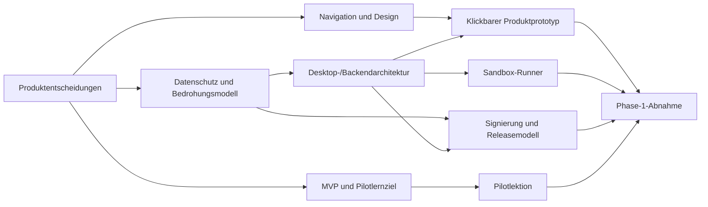

# CodeZone – Phase-1-Backlog und erster vertikaler Produktumfang

**Status:** Arbeitsplan  
**Version:** 0.1  
**Stand:** 21. Oktober 2026  
**Bezug:** [Produktgrundlage](DEVPATH_FOUNDATION.md), [Bedrohungsmodell](DEVPATH_THREAT_MODEL.md), [Design-Spezifikation](DEVPATH_DESIGN_SPEC.md), [Technologieentscheidung](DEVPATH_TECH_DECISION.md)

## 1. Zweck und Definition von Phase 1

Phase 1 legt die überprüfbare Produkt- und Technikgrundlage fest und bestätigt die größten Architekturannahmen mit einem vertikalen Prototyp. Das Ergebnis ist noch kein veröffentlichungsfähiges Lernprodukt und kein Produktionsbackend.

### Ergebnis am Ende von Phase 1

- Abgestimmter MVP-Umfang und Produktentscheidungen.
- Dokumentiertes Datenschutz-, Sicherheits-, Datenfluss- und Designmodell.
- Bewertete Technologieentscheidung inklusive Prototypergebnis.
- Startfähiger Desktop-Prototyp auf Windows, macOS und Linux.
- Ein kleiner Lernablauf mit lokaler Speicherung und einer isolierten Beispielausführung, sofern die Runner-Prüfung besteht.
- Nachvollziehbarer Release-/Signierungsprototyp und Backlog für die nächste Entwicklungsphase.

### Nicht das Ziel von Phase 1

- Fertige Website oder Produktionskonto.
- Vollständige Kurse oder adaptive KI-Lernplanung.
- Produktive Synchronisierung, Community oder Cloud-Codeablage.
- Freie Ausführung aller 14 Sprachen auf allen Plattformen.
- Veröffentlichung für Minderjährige oder breite öffentliche Beta.

## 2. Priorisierung

- **P0 – entscheidend:** muss abgeschlossen sein, damit Architektur und Umfang belastbar sind.
- **P1 – wichtig:** gehört zum vertikalen Prototyp oder ist nötig, um dessen Sicherheit/Benutzbarkeit zu beurteilen.
- **P2 – später:** bewusst außerhalb Phase 1; für nachfolgende Phasen eingeplant.

Schätzungen sind **grobe Teamaufwände in Personenwochen (PW)**, keine Kalenderzusagen. Sie setzen ein kleines Team voraus, das Produkt/Design, Desktop, Backend/Security und Lerninhalte abdecken kann. Infrastruktur, Beschaffung, Rechtsprüfung, externe Abhängigkeiten und Wartezeiten sind nicht enthalten.

## 3. Epics und Akzeptanzkriterien

### EPIC 0 – Projektsteuerung und Entscheidungspfad

**Ziel:** Offene Entscheidungen haben Verantwortliche, Kriterien und einen Zeitpunkt; keine Architekturannahme wird versehentlich als Beschluss behandelt.

| ID | Priorität | Arbeitspaket | Akzeptanzkriterien | Abhängigkeiten | Schätzung |
|---|---|---|---|---|---:|
| 0.1 | P0 | Rollen und Entscheidungseigner festlegen | Produkt-, Technik-, Datenschutz-/Security- und Lerninhaltsverantwortliche benannt; jede offene Entscheidung hat Owner und Fälligkeitsereignis. | Keine | 0.5 PW |
| 0.2 | P0 | Zielgruppe und MVP-Ziel konkretisieren | Ein primärer Pilotnutzer, ein konkretes Lernziel und Erfolgssignale beschrieben; Altersgruppen-/Minderjährigenumfang explizit entschieden. | 0.1 | 0.5 PW |
| 0.3 | P0 | Offene Produktentscheidungen schließen | Offlinekonto, erste Zielplattformen/-versionen, Zielmarkt, Sprache, erste Kursdomäne und Umfang der Onlinefunktionen entschieden oder explizit zurückgestellt. | 0.2 | 1 PW |
| 0.4 | P0 | Annahmen- und Änderungsregister führen | Annahmen, Risiko, Quelle, Owner und Entscheidungshistorie zentral nachvollziehbar; größere Produktänderung aktualisiert abhängige Dokumente. | 0.1 | 0.5 PW |

### EPIC 1 – Produktumfang und Lernerlebnis

**Ziel:** Ein kleines, vollständiges Nutzererlebnis definieren, das den Wert von CodeZone zeigt, ohne spätere Funktionen vorzutäuschen.

| ID | Priorität | Arbeitspaket | Akzeptanzkriterien | Abhängigkeiten | Schätzung |
|---|---|---|---|---|---:|
| 1.1 | P0 | MVP-Scope festlegen | Must-have, explizite Nichtziele und spätere Funktionen abgestimmt; Websiteumfang ist von Desktopumfang getrennt. | 0.2 | 0.5 PW |
| 1.2 | P0 | Vertikalen Lernablauf auswählen | Ein Einsteigerziel und ein Kursabschnitt mit Einstieg, Erklärung, Übung, Rückmeldung und Abschlusskriterium benannt. | 1.1 | 0.5 PW |
| 1.3 | P1 | Pilotlektion schreiben | Inhalt fachlich geprüft, in kurze Schritte gegliedert, Lösungshinweise abgestuft; Aufgaben können lokal ohne Konto ausgeführt werden. | 1.2, 5.1 | 1–2 PW |
| 1.4 | P1 | Nutzertests für Kernablauf durchführen | Teilnehmende aus unterschiedlicher Vorerfahrung verstehen Start, Lernziel, Hinweis und Fortschritt; Befunde und Änderungen dokumentiert. | 3.1, 1.3 | 1 PW |
| 1.5 | P2 | Lernplanalgorithmus spezifizieren | Signale, Erklärbarkeit, Korrekturmöglichkeiten und Fehlerschutz festgelegt, bevor adaptive Entscheidungen produktiv gespeichert werden. | 1.4, Datenschutzprüfung | Nach Phase 1 |

### EPIC 2 – Datenschutz, Sicherheit und Bedrohungsmodell

**Ziel:** Datenflüsse und Mindestkontrollen sind umsetzbar und überprüfbar, bevor echte Nutzer-/Codeinhalte online gehen.

| ID | Priorität | Arbeitspaket | Akzeptanzkriterien | Abhängigkeiten | Schätzung |
|---|---|---|---|---|---:|
| 2.1 | P0 | Dateninventar und Zweckbindung finalisieren | Für jede Datenart Zweck, Ort, Rechts-/Einwilligungsgrundlage zu prüfen, Zugriff, Frist, Export und Löschung dokumentiert. | 0.3 | 1 PW |
| 2.2 | P0 | Bedrohungsmodell reviewen | Threat Model mit Desktop-, Website-, API- und Updateverantwortlichen durchgesehen; Risiken priorisiert, Owner und Mitigationstermin festgelegt. | 0.1, 2.1 | 1 PW |
| 2.3 | P0 | Schutzbedarf von Minderjährigen entscheiden | Zielalter, Kontoregeln, Communitystatus und erforderliche Rechtsprüfung dokumentiert; Community bleibt gesperrt, solange nicht freigegeben. | 0.2, 0.3 | 0.5–1 PW |
| 2.4 | P1 | Datenfluss für Prototyp festlegen | Prototyp erhebt nur lokale Profil-/Fortschrittsdaten; jede Netzwerkverbindung ist dokumentiert; Nutzercode/Prompts werden nicht übertragen. | 2.1, 4.1 | 0.5 PW |
| 2.5 | P1 | Sicherheitsanforderungen in Architektur-Backlog überführen | Signierung, OS-Keychain, IPC-Allowlist, Sandboxgrenze, Logging und Abhängigkeitspflege als konkrete technische Aufgaben angelegt. | 2.2, 4.1 | 1 PW |
| 2.6 | P2 | Datenschutz-Folgen-/Rechtsprüfung | Fachprüfung für Zielmarkt, Konten, Minderjährige, KI-Anbieter und Community abgeschlossen, falls nach Rechtslage erforderlich. | 0.3, Dienstleisterentscheidungen | Nach Phase 1 / vor Beta |

### EPIC 3 – Navigation, Design und Barrierefreiheit

**Ziel:** Die vereinbarten Ansichten sind als klickbarer Prototyp nachvollziehbar und mit grundlegenden Bedienungshilfen geprüft.

| ID | Priorität | Arbeitspaket | Akzeptanzkriterien | Abhängigkeiten | Schätzung |
|---|---|---|---|---|---:|
| 3.1 | P0 | Design-Spezifikation bestätigen | Navigation und Wireframes durch Produktverantwortliche geprüft; Funktionsstatus von Community/Code Base korrekt dargestellt. | 0.2 | 0.5 PW |
| 3.2 | P1 | Tokens und Komponentenprototyp erstellen | Farb-, Typografie-, Abstands- und Bewegungs-Tokens zentral implementiert; kein verstreutes Hardcoding in Kernkomponenten. | 3.1, 4.1 | 1 PW |
| 3.3 | P1 | Klickbarer Kernablauf | Ersteinrichtung, Heute, Lernen, Übung, Code Studio und Datenschutzansicht als zusammenhängender Fluss klickbar. | 3.1 | 1–2 PW |
| 3.4 | P1 | Accessibility-Review | Tastaturfokus, logische Screenreader-Reihenfolge, Statuslabel, 200-%-Textskalierung und reduced motion für Kernfluss geprüft; Befunde dokumentiert. | 3.3 | 1 PW |
| 3.5 | P1 | Kontrastwerte messen und Tokens anpassen | Text-/UI-Kontraste für helle und dunkle Themes gemessen; Abweichungen korrigiert und Messergebnisse im Designreview erfasst. | 3.2 | 0.5 PW |

### EPIC 4 – Desktop-Technologie und lokale Architektur

**Ziel:** Technologieempfehlung durch einen schlanken, plattformübergreifenden Prototyp bestätigen oder korrigieren.

| ID | Priorität | Arbeitspaket | Akzeptanzkriterien | Abhängigkeiten | Schätzung |
|---|---|---|---|---|---:|
| 4.1 | P0 | Tauri-Prototyp-Repository und Buildmatrix | Windows, macOS und Linux können dokumentiert aus einem Repository gebaut werden; Mindestversionen und Toolchains festgehalten. | 0.3 | 1–2 PW |
| 4.2 | P1 | Renderer/native IPC begrenzen | Renderer kann nur typisierte Allowlist-Kommandos aufrufen; keine generische Shell, arbitrary path oder unbeschränkte Dateisystemberechtigung. | 4.1, 2.5 | 1 PW |
| 4.3 | P1 | Lokale Profil-/Fortschrittsdaten | SQLite-Schema versioniert; Einstellungen und Pilotfortschritt über Neustart verfügbar; Export-/Löschweg dokumentiert. | 4.1, 2.4 | 1 PW |
| 4.4 | P1 | Editorintegration evaluieren | Monaco (oder begründete Alternative) zeigt Pilotcode und unterstützt Kernbedienung; Leistung, Paketgröße und Lizenzbestand geprüft. | 4.1, 1.3 | 1 PW |
| 4.5 | P1 | Desktop-Betriebszustände | Offline, Laden, Fehler, ungespeicherte Änderung und Updatehinweis haben verständliche Zustände; lokale Abläufe funktionieren ohne Netzwerk. | 4.2, 4.3 | 1 PW |
| 4.6 | P1 | Framework-Entscheidung aktualisieren | G1–G3 und G6 aus Technologieentscheidung bewertet; Tauri bestätigt oder Electron/Flutter mit Befund und Kosten neu verglichen. | 4.1–4.5 | 0.5 PW |

### EPIC 5 – Codeausführung und Editorgrenze

**Ziel:** Nachweisen, ob eine sichere lokale Ausführung auf Zielplattformen ohne privilegierte oder versteckte Installation möglich ist.

| ID | Priorität | Arbeitspaket | Akzeptanzkriterien | Abhängigkeiten | Schätzung |
|---|---|---|---|---|---:|
| 5.1 | P0 | Sandbox-Optionen pro OS bewerten | Je OS Bedrohungsgrenze, Installationsrechte, Dateisystem-/Netzwerk-/Ressourcenbeschränkung und Betriebsaufwand dokumentiert. | 2.2, 4.1 | 1–2 PW |
| 5.2 | P1 | Einen Pilot-Runner implementieren | Ein Beispielprogramm läuft außerhalb des UI-Prozesses, in temporärem Workspace, ohne Netzwerk und ohne Zugriff auf Home/Token; Laufzeit und Speicher sind begrenzt. | 5.1, 4.2 | 2–4 PW |
| 5.3 | P1 | Ablehnung/Fehler verständlich behandeln | Wenn Runner fehlt oder Isolation nicht möglich ist, wird Codeausführung blockiert und erklärt; es gibt keinen stillen unsicheren Fallback. | 5.2 | 0.5 PW |
| 5.4 | P1 | Sandboxfreigabe treffen | G4 erfüllt auf den tatsächlich unterstützten Zielplattformen oder Codeausführung wird für nicht bestandene Plattformen deaktiviert. | 5.2, Security Review | 1 PW |
| 5.5 | P2 | Mehrsprachige Runtime-Matrix | Runtimeversionen, Pflege-/Patchprozess und Ressourcenprofile je Sprache definiert. | 5.4 | Nach Phase 1 |

### EPIC 6 – Website, Konto und Backendgrenzen

**Ziel:** Im Prototyp die Onlinegrenzen festlegen, ohne unnötig Produktionsdienste einzuführen.

| ID | Priorität | Arbeitspaket | Akzeptanzkriterien | Abhängigkeiten | Schätzung |
|---|---|---|---|---|---:|
| 6.1 | P0 | Websiteumfang entscheiden | Informationsarchitektur und Download-/Systemanforderungsseiten definiert; keine nicht nötigen Trackingprofile. | 0.3, 1.1 | 0.5 PW |
| 6.2 | P0 | Konto-/Offlinezugang entscheiden | Nutzer kann lokale Lernfunktionen ohne Konto verwenden oder begründete Kontopflicht ist ausdrücklich beschlossen; Datenfolgen erklärt. | 0.3, 2.1 | 0.5 PW |
| 6.3 | P1 | API-Verträge skizzieren | Nur für Konto/Katalog/Update benötigte Endpunkte, Authentifizierung, Fehler, Versionierung und Limits dokumentiert. | 6.1, 6.2 | 1 PW |
| 6.4 | P1 | Backend-/Hostingentscheidung vorbereiten | Zielregion, Datenschutz, Kosten, Betrieb, Backups und Exitfähigkeit vergleichbar dokumentiert; kein Anbieter aus Bequemlichkeit vorentschieden. | 0.3, 2.1 | 1–2 PW |
| 6.5 | P2 | Produktionsidentität und Website bauen | Sichere Anmeldung, Wiederherstellung, Kontolöschung, Account-Support und Webhärtung umgesetzt. | 6.2, Rechts-/Providerprüfung | Nach Phase 1 |

### EPIC 7 – Lieferkette und Releaseprototyp

**Ziel:** Die sichere Herkunft einer Appversion vom Quellcommit bis zum Installationsartefakt nachvollziehen.

| ID | Priorität | Arbeitspaket | Akzeptanzkriterien | Abhängigkeiten | Schätzung |
|---|---|---|---|---|---:|
| 7.1 | P0 | Signierungs- und Releasemodell definieren | Signierrollen, Schlüsselaufbewahrung, Freigabe, Plattformpakete, Rollout, Widerruf und Notfallrotation beschrieben. | 2.2, 4.1 | 1 PW |
| 7.2 | P1 | Testbuild signieren/verifizieren | Mindestens ein Testartefakt je machbarer Plattform wird signiert; Verifikation vor Installation; manipuliertes Paket wird abgewiesen. | 7.1, 4.1 | 1–2 PW |
| 7.3 | P1 | Buildprovenance und SBOM erzeugen | Commit, Toolchain, Abhängigkeiten, Lizenzliste und Artefakthash sind pro Build nachvollziehbar. | 4.1, 7.1 | 1 PW |
| 7.4 | P1 | Updateentscheidung prüfen | Plattformkanäle und Rollback/Downgradeverhalten dokumentiert; Linux-Distribution ist konkret gewählt oder als separates Paketmodell offengehalten. | 7.2 | 1 PW |

### EPIC 8 – Lerninhalte, Qualität und Abnahme

**Ziel:** Ein kleiner Lernabschnitt ist fachlich und didaktisch geeignet, bevor Inhaltsproduktion skaliert.

| ID | Priorität | Arbeitspaket | Akzeptanzkriterien | Abhängigkeiten | Schätzung |
|---|---|---|---|---|---:|
| 8.1 | P0 | Kurs- und Übungsformat definieren | Lernziel, Erklärung, Beispiel, Aufgabe, Hinweisstufen, Bewertung und Barrierefreiheitsregeln als Formatvorlage dokumentiert. | 1.2, 3.1 | 0.5 PW |
| 8.2 | P1 | Pilotinhalt fachlich prüfen | Beispielcode läuft wie erwartet; Lösung und Fehlerhinweise sind korrekt; Fachreview durch qualifizierte Person protokolliert. | 8.1, 5.2 | 0.5–1 PW |
| 8.3 | P1 | Nutzungsfeedback auswerten | Beobachtete Abbrüche, Missverständnisse und Hilfebedarf in priorisierte Änderungen übersetzt; keine Leistungsbewertung der Lernenden. | 1.4, 8.2 | 0.5 PW |
| 8.4 | P0 | Phase-1-Review und Folgeroadmap | Ziele, nicht bestandene Gates, Risiken, offene Anbieter-/Rechtsfragen und Phase-2-Backlog von Verantwortlichen bestätigt. | Alle P0/P1 | 1 PW |

## 4. Abhängigkeiten in Kurzform

## 5. Phase-1-Gates

| Gate | Erforderlicher Nachweis | Entscheidung |
|---|---|---|
| G0 Produkt | Primäre Pilotzielgruppe, Lernziel, Offline-/Kontomodell und explizite Nichtziele abgestimmt. | Scope freigeben oder neu schneiden. |
| G1 Daten | Dateninventar, Zwecke, lokale/Serverorte und optionale Übermittlungen widerspruchsfrei dokumentiert. | Prototypdatenflüsse freigeben. |
| G2 UX | Navigation und vertikaler Lernablauf verstanden; kritische Barrierefreiheitsbefunde haben Owner. | UI-Prototyp fortsetzen oder korrigieren. |
| G3 Plattform | Windows/macOS/Linux-Build- und Paketpfade realistisch; Framework anhand Evidenz bestätigt oder gewechselt. | Technologieentscheidung aktualisieren. |
| G4 Codeausführung | Runner hat nachweislich keinen unbeschränkten Netzwerk-/Dateizugriff und begrenzte Ressourcen auf freizugebenden Plattformen. | Ausführung pro OS freigeben oder deaktivieren. |
| G5 Release | Herkunft und Signatur eines Testbuilds prüfbar; Widerruf/Rotation erklärt. | Releasepipeline als Grundlage zulassen. |
| G6 Lerninhalt | Eine Pilotlektion fachlich korrekt und von Testpersonen verständlich bearbeitet. | Inhaltsformat skalieren oder überarbeiten. |
| G7 Phase 2 | P0 erledigt; P1 erledigt oder mit begründetem Reststatus; Risiken, Kostenannahmen und Verantwortliche bestätigt. | Phase 2 starten oder offene Blocker zuerst schließen. |

## 6. Vorschlag für Lieferreihenfolge

1. **Woche/Iteration A – Entscheidungen:** EPIC 0, 1.1–1.2, 2.1–2.3, 3.1, 6.1–6.2, 7.1.
2. **Iteration B – Prototypfundament:** 4.1–4.3, 3.2–3.3, 6.3, 8.1–8.2.
3. **Iteration C – kritische technische Annahmen:** 4.4–4.6, 5.1–5.4, 7.2–7.4.
4. **Iteration D – Nutzerprüfung und Abnahme:** 1.4, 3.4–3.5, 8.3–8.4, Gate-Review.

Iterationen sind Reihenfolgeempfehlungen und keine Zusage einer festen Dauer. Runner- und Releasearbeit kann parallel nur erfolgen, wenn Verantwortliche und Plattformbuilds verfügbar sind.

## 7. Phase-2-Kandidaten

Erst nach Gate G7 priorisieren:

1. Pilotkurs als lokaler, vollständiger Lernpfad.
2. Website mit Download, Systemanforderungen und Konto, falls Kontomodell dies erfordert.
3. Weitere Kursinhalte und adaptive Lernplanung.
4. Code Studio mit unterstützten Laufzeiten und Tutor-Hinweisen.
5. Lokale Code Base mit Git-ähnlicher Versionsgeschichte.
6. Signierte öffentliche Builds und kontrolliertes Updatekanalmodell.
7. Optionale KI nur nach Datenanbieter-/Vertragsprüfung und sauberem Opt-in.
8. Sync und Community separat; Community erst nach Moderations- und Minderjährigenschutzfreigabe.

## 8. Risiken und Voraussetzungen

- Ein kleines Team kann nicht gleichzeitig drei Betriebssysteme, mehrere Sprachen, Onlineplattform und didaktische Inhalte ohne Priorisierung fertigstellen. Daher Pilotumfang eng halten.
- Der Sandbox-Runner ist ein Sicherheitsblocker und kann weitere Sprachunterstützung begrenzen.
- App-Signierung, macOS-Notarisierung, Windows-SmartScreen-Vertrauen und Linux-Paketpflege benötigen früh eingeplante Beschaffung und Betrieb.
- Nutzung von KI im Produkt erfordert eine spätere Entscheidung über lokale Modelle oder Anbieter, Vertragsbedingungen, Kosten, Region und Datenaufbewahrung.
- Rechtsraum, Altersziel und Kontomodell bestimmen Pflichten für Website, Einwilligung und Datenlöschung; diese sind nicht durch einen allgemeinen Produktentwurf erledigt.
- Externe Nutzertests erfordern Rekrutierung, barrierefreie Teilnahme und eine datensparsame Einwilligungs-/Feedbackpraxis.

## 9. Definition of Done für Phase 1

Phase 1 ist abgeschlossen, wenn:

- alle Phase-1-Grundlagendokumente versioniert und untereinander konsistent sind;
- P0-Arbeitspakete abgeschlossen sind oder eine verantwortliche Person einen expliziten, begründeten Ausnahmebeschluss dokumentiert hat;
- der vertikale Prototyp die bestandenen Entscheidungstore belegt und nicht bestandene Tore klar einschränkt;
- es keinen stillen unsicheren Ausführungs- oder Datenübertragungsfallback gibt;
- Phase-2-Umfang, Risiken, Verantwortliche und nötige externe Entscheidungen vorliegen;
- offene Rechts-, Hosting-, Marken-, Lizenz- und Altersfragen nicht als bereits gelöst dargestellt werden.

## 10. Arbeitsmodus für Backlogpflege

Jedes Arbeitspaket erhält bei Umsetzung zusätzlich: Owner, Status, konkrete Version/Plattform, Aufwandsschätzung, Abnahmeevidenz, offene Risiken und Link zu betroffenen Entscheidungen. Bei neuem Umfang wird ein bestehendes Paket verschoben oder entfernt, statt den Phase-1-Umfang still anwachsen zu lassen.
