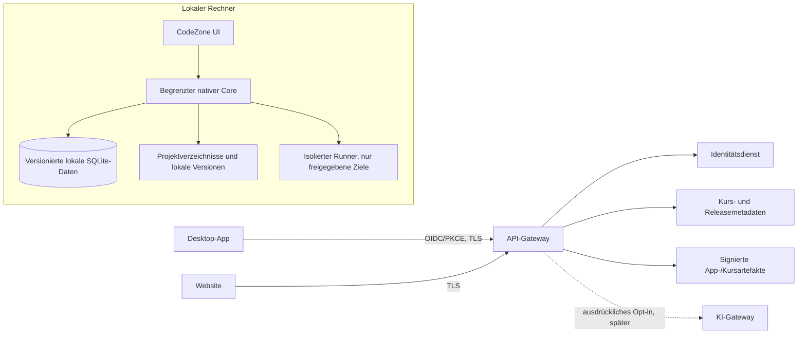
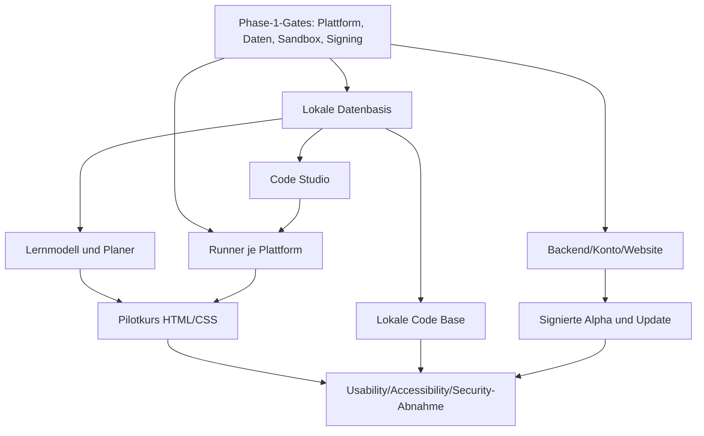

# CodeZone – vollständiger Plan für Phase 2

**Status:** Produkt- und Umsetzungsplan  
**Version:** 0.1  
**Stand:** 21. Oktober 2026  
**Voraussetzung:** Phase-1-Gates aus [DEVPATH_PHASE1_BACKLOG.md](DEVPATH_PHASE1_BACKLOG.md) sind geprüft und freigegeben.  
**Bezug:** [Produktgrundlage](DEVPATH_FOUNDATION.md), [Sicherheitsmodell](DEVPATH_THREAT_MODEL.md), [Design-Spezifikation](DEVPATH_DESIGN_SPEC.md), [Technologieentscheidung](DEVPATH_TECH_DECISION.md), [Implementierungsstand](DEVPATH_PHASE1_IMPLEMENTATION.md)

## 1. Ziel und Ergebnis

Phase 2 verwandelt das technische Fundament in eine **private, installierbare Alpha von CodeZone**, die einen vollständigen Lernablauf von der Zielwahl bis zum überprüfbaren Kursabschluss bietet. Lernen und private Projekte funktionieren lokal; Konto, Update und Kurskatalog stehen als abgesicherte Onlinefunktionen bereit. Externe KI, Sync und öffentliche Community werden nicht stillschweigend vorausgesetzt.

### Zielzustand am Ende

- Installierbare, versionierte Desktop-App für freigegebene Windows-, macOS- und Linux-Zielsysteme.
- Lokales Profil und versionierte, exportierbare lokale Datenspeicherung statt `localStorage`.
- Vollständiger, fachlich geprüfter Pilotlernpfad für HTML und CSS mit Übungen, Hinweisen, Wiederholung und Abschlusskriterium.
- Code Studio mit Editor, Datei-/Projektverwaltung und **nur dort freigeschalteter Codeausführung, wo der jeweilige Sandbox-Gate bestanden ist**.
- Lokale Code Base mit nachvollziehbarer Projekthistorie oder einem expliziten, getesteten Git-Workflow.
- Konto und Website nur für die festgelegten Onlinefunktionen; Anmeldung bleibt optional für lokale Lernabläufe, sofern Phase 1 keine begründete Gegenentscheidung trifft.
- Signierte Releases, sichere Updatekette, Support- und Datenschutzhinweise sowie Datenexport/-löschung.
- Private Alpha mit dokumentierter Nutzungs- und Sicherheitsrückmeldung sowie einem priorisierten Phase-3-Backlog.

### Definition einer privaten Alpha

Ein beschränkter, eingeladener Personenkreis testet ein funktionsfähiges Produkt über einen dokumentierten Zeitraum. Die Alpha ist kein öffentlicher Store-Start und kein Versprechen, dass alle Kurse, Sprachen, KI-Funktionen oder Communityfunktionen verfügbar sind.

## 2. Umfang und Nichtumfang

### Im Umfang

- Phase-1-Restarbeiten als verpflichtendes **Gate 0**: Desktop-Buildmatrix, Sicherheitsreview, Datenschutzinventar, Nutzertest, Accessibilityreview, Sandboxentscheidung und Release-/Signierprototyp.
- Installation, Aktualisierung und lokale Datenmigration.
- Ersteinrichtung mit Lernziel, Vorkenntnis und Zeitbudget.
- Erklärbarer, regelbasierter persönlicher Lernplan; KI wird nicht benötigt, um den Lernplan zu erstellen.
- Pilotkurs **HTML + CSS: erste responsive Webseite** mit einem klaren Projektziel.
- Code Studio: Monaco-Editor, Projektbaum, lokaler Speicher, Aufgabenansicht, Fehlerrückmeldung und sandboxbasierte Ausführung ausschließlich für freigegebene Sprachen/Plattformen.
- Code Base lokal: Speichern benannter Versionen, Diff, Wiederherstellen und Export.
- Website: Produktinformationen, Systemanforderungen, Datenschutz/Sicherheit, Download, Konto und Supportweg entsprechend dem Kontomodell.
- Konto für Aktualisierungen/optionale Kontofunktionen; keine Abhängigkeit des Offline-Lernens von Anmeldung.
- Lokale Diplomanzeige für den abgeschlossenen Pilotkurs; Abschlussanimation als optionale, überspringbare Variante.
- Betriebsgrundlage für private Alpha: signierte Pakete, Updatekanal, Vorfallkontakt, Fehlerbericht nur mit Zustimmung und Löschweg.

### Ausdrücklich nicht im Phase-2-Umfang

- Alle vierzehn Programmiersprachen als vollständige Lernpfade.
- Alle sechs umfangreichen Themenkurse vollständig.
- Öffentliche Projektcommunity, Direktnachrichten, Kommentare und offene Uploads.
- Cloud-Synchronisierung von Quellcode, Lernhistorie oder Code Base.
- Externe KI-Übermittlung als Standard oder automatische Änderungen am Code.
- Öffentliche, rechtlich ungeprüfte Angebote für Minderjährige.
- Staatlich oder beruflich anerkannte Zertifikate.
- Produktions-SLA oder uneingeschränkter öffentlicher Betrieb.

Der Umfang ist bewusst ein vertikaler Ausschnitt des späteren CodeZone-Produkts. Neue Wünsche werden priorisiert, indem andere Arbeit aus Phase 2 herausgenommen wird.

## 3. Nutzergruppen und Alpha-Personas

1. **Einsteiger:** kennt keine Programmierung, braucht klare Begriffe, kurze Erklärungen und sichtbare nächste Schritte.
2. **Lernende mit Grundlagen:** kennt erste HTML-/CSS-Elemente und möchte Projekte praktisch umsetzen.
3. **Lernende mit unterschiedlichen Bedienbedürfnissen:** nutzt Tastatur, Screenreader, größere Schrift oder reduzierte Bewegung.
4. **Erfahrene technische Testperson:** bewertet Editor, Projektablage, Updates und Fehlerzustände.

Altersgruppen sind nicht anhand des Geburtsdatums zu personalisieren. Wenn Minderjährige in der Alpha teilnehmen sollen, müssen Zielmarkt, Einwilligungsweg, Datensparsamkeit und Testverfahren vor Rekrutierung rechtlich und organisatorisch freigegeben sein. Bis dahin läuft die Alpha nur im freigegebenen Alters-/Einwilligungsrahmen.

## 4. Produkterlebnis

### 4.1 Ersteinrichtung

- Sprache, Lernziel, Vorkenntnis und verfügbare Lernzeit abfragen.
- Jede Frage ist verständlich, optional wenn fachlich möglich und einzeln überspringbar.
- Konto, externe KI, Diagnose und Sync nicht in der Abfrage verstecken.
- Nach der Abfrage den vorgeschlagenen Plan mit Begründung zeigen und anpassbar machen.

### 4.2 Personalisierter Lernplan

Phase 2 verwendet zunächst nachvollziehbare Regeln, keine undurchsichtige Vorhersage:

- Lektionen als Fähigkeiten mit Voraussetzungen und mehreren Verständnisnachweisen modellieren.
- Fortschritt über Übungen, Wiederholungen, benötigte Hinweise und Selbsteinschätzung ableiten.
- Bei Unsicherheit eher eine kurze Wiederholung anbieten, statt Lernende als gescheitert zu markieren.
- Sitzungszeit aus selbst gewähltem Wochenbudget planen; Vorschlag jederzeit ändern/pausieren.
- Empfehlung zeigt „Warum diese Lektion?“ mit konkreten Signalen (z. B. „Layout-Grundlage zuletzt sicher gelöst“).
- Lernverhaltensdaten bleiben lokal. Keine Rangliste, Streak-Strafe oder Bewertung außerhalb des Lernzwecks.

### 4.3 Pilotlernpfad

**Pfad:** „Erste responsive Webseite mit HTML und CSS“.

1. Dokumentstruktur und semantische HTML-Elemente
2. Links, Bilder und zugängliche Alternativtexte
3. CSS-Regeln, Farben und Typografie
4. Boxmodell, Abstände und Layout
5. Flexbox und responsives Verhalten
6. Mini-Projekt: persönliche Infoseite
7. Wiederholung, Reflexion und lokaler Kursabschluss

Jede Lektion enthält Lernziel, kurze Erklärung, Beispiel, Übung, abgestufte Hinweise, Ergebnisfeedback und gegebenenfalls Wiederholung. Kursabschluss erfordert definierte Kompetenznachweise; ein einzelner Button darf nicht automatisch ein Diplom verleihen.

### 4.4 Code Studio

- Tabs, Projektbaum, Syntaxhervorhebung, Suchen, automatische Einrückung und Status „lokal gespeichert“.
- Import/Export einzelner Projekte über Nutzeraktion.
- Editor bleibt ohne Konto und Netzwerk nutzbar.
- Tutor in Phase 2 zunächst **regel-/kursbasiert**: Fehlererklärung und Hinweise aus lokalem Kursmaterial; kein Modellzugriff auf Dateien.
- Externe KI bleibt hinter einem Featureflag und wird nur nach eigener Anbieter-, Vertrags- und Datenschutzfreigabe aktiviert.
- Codeänderung durch automatische KI ist nicht Bestandteil der Alpha. Spätere Vorschläge müssen als Diff mit Zustimmung umgesetzt werden.

### 4.5 Code Base lokal

Phase 2 liefert eine lokale, nachvollziehbare Versionierung. Vor Implementierung ist auf Basis Phase 1 zwischen eigener Snapshot-Historie und Git als Engine zu entscheiden:

- Name und optionale Notiz für jeden gespeicherten Stand.
- Liste mit Zeit, Änderungsbeschreibung und Projektdateien.
- Textdiff für unterstützte Textdateien.
- Wiederherstellung erzeugt einen neuen Stand; sie vernichtet nicht unbemerkt jüngere Arbeit.
- Git-Metadaten, `.git`-Inhalte, Secrets und lokale absolute Pfade werden nicht automatisch in Exporte aufgenommen.
- UI erklärt klar, ob ein Projekt ein normales Verzeichnis, Git-Repository oder beides ist.

### 4.6 Konto und Website

- Lokales Lernen ohne Konto bleibt möglich.
- Anmeldung verwendet den in Phase 1 gewählten Identitätsanbieter und einen Systembrowser-/PKCE-Flow.
- Website erklärt Mindestanforderungen, unterstützte Plattformen, Herausgeber, Downloadversion und Datenschutz.
- Kontowiederherstellung, Datenexport und Kontolöschung sind vor Alpha mit echten Abläufen geklärt.
- Kein vollständiger Projektcode und kein Lernverhalten wird bei Anmeldung übertragen.
- Website und App zeigen denselben Releasekanal und verweisen nicht auf nicht signierte Artefakte.

### 4.7 Diplom und Animation

- Digitales Alpha-Diplom benennt Pilotkurs, erreichte Lernziele und Abschlussdatum.
- Anzeige ist lokal; Teilen/Verifizieren ist nicht aktiv.
- Abschlussanimation ist 10 Sekunden höchstens, abbrechbar, mit reduzierter Animation oder vollständig abschaltbar.
- Keine Animation blockiert den nächsten Schritt oder erschwert Screenreader-/Tastaturbedienung.

## 5. Architekturziel für Phase 2

### Architekturregeln

- Backend startet als modularer Monolith mit getrennten Modulen und Rollen; Microservices nur bei nachgewiesenem Bedarf.
- PostgreSQL speichert nur Konto-/Katalog-/Betriebsmetadaten, die ein Serverzweck wirklich benötigt.
- Quellcode, Code-Base-Historie und Lernverhalten bleiben lokal in Phase 2.
- Native Brücke bleibt klein, typisiert und per Allowlist begrenzt.
- Runner erhält keinen Zugriff auf App-Tokens, Benutzersitzungen, Browserprofile oder beliebige Home-Verzeichnisse.
- API autorisiert jedes Objekt serverseitig; Clientzustand ist nicht vertrauenswürdig.
- Signier-, Datenbank- und Identitätsgeheimnisse sind getrennt; nichts davon gelangt ins Frontendbundle oder Repository.
- Datenbankmigrationen sind versioniert, rückwärtskompatibel wo möglich und vor Release wiederherstellbar.

## 6. Epics, Arbeitspakete und Abnahmekriterien

Aufwand ist eine grobe Team-Schätzung in Personenwochen (PW). Externe Rechts-/Datenschutzprüfung, Beschaffung von Signierung, Warteschlangen und Rekrutierung sind separat zu planen. Dauer in Kalenderwochen hängt von Teamgröße, Plattformzugang und Freigaben ab.

### EPIC 0 – Phase-1-Gates schließen (Pflicht)

| ID | Arbeitspaket | Abnahmekriterium | Aufwand |
|---|---|---|---:|
| 0.1 | Produktentscheidungen und Zielgruppe beschließen | MVP, Kontomodell, Zielalter, Plattform-Mindestversionen, Zielmarkt, Pilotkurs und Verantwortliche sind dokumentiert. | 1–2 PW |
| 0.2 | Tauri-Rust-Buildmatrix | Debug- und Paketbuild laufen auf dedizierten Windows-/macOS-/Linux-Runnern; Mindestversion und Laufzeitbibliotheken dokumentiert. | 2–4 PW |
| 0.3 | Threat-/Datenschutzreview | Dateninventar und Datenflüsse sind widerspruchsfrei; kritische Risiken haben Verantwortlichen und Gegenmaßnahme. | 1–2 PW |
| 0.4 | Sandboxentscheid | Runner-Begrenzung pro OS implementierbar; Angriffsgrenze und Disabled-Fallback definiert. | 2–4 PW |
| 0.5 | Release-/Signierprototyp | Signatur vor Installation verifiziert; Artefaktmanipulation wird abgewiesen; Schlüsselzugriff und Rotation getrennt. | 2–3 PW |
| 0.6 | Accessibility- und Lernendentest | Mindestens ein moderierter Test pro zentralem Nutzerprofil, Befunde dokumentiert, kritische Barrieren eingeplant. | 2–3 PW |
| 0.7 | Gate-Abnahme | G0–G6 aus Phase 1 haben Evidenz oder explizite Einschränkung; keine Produktionsfreigabe aus bloßer Dokumentation. | 0.5 PW |

**Gate:** Ohne erfolgreichen bzw. explizit begrenzten 0.2–0.5 wird die betroffene Plattform oder Codeausführung nicht in Alpha aufgenommen.

### EPIC 1 – Lokale Datengrundlage und Datenkontrolle

| ID | Arbeitspaket | Abnahmekriterium | Aufwand |
|---|---|---|---:|
| 1.1 | LocalStorage ablösen | Native versionierte SQLite-Datenbank; Migration von Prototypdaten wird angeboten oder Daten können exportiert und neu importiert werden. | 2–3 PW |
| 1.2 | Datenzugriffsschicht | Repository-/Service-Schicht trennt UI von SQL; Schemaänderungen haben Migration und Fehlerbehandlung. | 1–2 PW |
| 1.3 | Export, Import und Löschen | Nutzer kann Profil/Fortschritt exportieren, Import prüfen und lokale Daten gezielt löschen; Fehler werden ohne Teilverlust gemeldet. | 1–2 PW |
| 1.4 | OS-Geheimnisspeicher | Tokens, falls Konto aktiv, liegen im OS Credential Store; kein Klartextfallback ohne sichtbare und begrenzte Entscheidung. | 1–2 PW |
| 1.5 | Offline-/Recoveryzustände | App startet ohne Netz; beschädigte/gesperrte Datenbank wird erkennbar behandelt und überschreibt keine Nutzerdaten still. | 1–2 PW |

### EPIC 2 – Lernmodell, Lernplan und Inhalte

| ID | Arbeitspaket | Abnahmekriterium | Aufwand |
|---|---|---|---:|
| 2.1 | Kursformat und Kompetenzgraph | Lektionen, Fähigkeiten, Voraussetzungen, Übungen, Hinweise und Nachweise maschinenlesbar und versioniert beschrieben. | 2–3 PW |
| 2.2 | Ersteinrichtung | Ziel, Erfahrung und Lernzeit werden erklärt, gespeichert, übersprungen/angepasst; keine unnötigen Altersdaten. | 1–2 PW |
| 2.3 | Regelbasierte Planerstellung | Plan verwendet ausdrücklich gewählte Ziele und lokale Fortschrittssignale; Empfehlung enthält Begründung und editierbare Zeitvorschläge. | 2–3 PW |
| 2.4 | Plananpassung | Bei Pausen, Fehlversuchen oder schnellen Fortschritten wird der Plan ohne Strafhinweise angepasst; Nutzer kann Änderungen rückgängig machen. | 1–2 PW |
| 2.5 | HTML-/CSS-Pilotkurs | Sieben Lernabschnitte und Mini-Projekt fachlich/didaktisch geprüft; alle Aufgaben, Lösungen und Hinweise sind versioniert. | 4–6 PW |
| 2.6 | Lernergebnisse/Wiederholung | Übung bewertet definierte Kriterien lokal; Unsicherheit führt zu Hilfsangebot/Review statt pauschalem Nichtbestehen. | 2–3 PW |
| 2.7 | Kursfortschritt | Heute- und Lernpfadansicht zeigen aktuelle Einheit, Wiederholung, Abschlussstatus und Offlineverfügbarkeit korrekt. | 1–2 PW |

### EPIC 3 – Code Studio und Sandboxrunner

| ID | Arbeitspaket | Abnahmekriterium | Aufwand |
|---|---|---|---:|
| 3.1 | Editorhülle und Projektbaum | Öffnen, Wechseln, Speichern, Suchen und Statusanzeige funktionieren ohne Konto; Projektpfad wird auf Wahl der Person begrenzt. | 2–4 PW |
| 3.2 | Runner-Protokoll | UI sendet Aufgabe und begrenzte Eingabe an separaten Prozess; Antwortschema, Timeout, Exitcode und Fehler sind definiert. | 1–2 PW |
| 3.3 | Sandbox je OS | Filesystem, Netzwerk, Prozesszahl, CPU, RAM und Dauer begrenzt; kein Zugriff auf Token/Home/andere Prozesse. | 4–8 PW |
| 3.4 | Pilotruntime | Nur für bestandene Plattformen; Runtimeversion fest, Patchprozess dokumentiert, keine Runtime automatisch aus fremder Quelle installiert. | 2–4 PW |
| 3.5 | Aufgabenfeedback | erwartetes Verhalten und häufige Fehler werden verständlich angezeigt; Rohlogs enthalten keinen vollständigen Projektinhalt. | 1–2 PW |
| 3.6 | Fehler-/Abbruch-UX | Runner fehlt, crasht, Timeout oder Ressourcenlimit: verständlicher Zustand, lokaler Code bleibt erhalten, kein unsicherer Fallback. | 1–2 PW |
| 3.7 | Tutor ohne Modell | Hinweise aus Kursmaterial und statische Fehlererklärungen verfügbar; keine stille Datei-/Netzwerkaufnahme. | 2–3 PW |

Codeausführung wird je Plattform über Featureflag freigegeben. Wird die Sicherheitsgrenze nicht nachgewiesen, bleibt der Editor nutzbar und Ausführung gesperrt.

### EPIC 4 – Code Base lokal

| ID | Arbeitspaket | Abnahmekriterium | Aufwand |
|---|---|---|---:|
| 4.1 | Snapshot-/Git-Entscheidung | Vergleich zu Wartung, Lizenz, Dateigröße, Export und Nutzerverständnis abgeschlossen; Entscheidung schriftlich begründet. | 0.5–1 PW |
| 4.2 | Versionen anlegen | Nutzer kann benannten Stand speichern; jeder Commit/Snapshot ist lokal und Projektzuordnung eindeutig. | 2–4 PW |
| 4.3 | Historie und Diff | Versionen lesbar sortiert; unterstützter Textdiff; Binärdateien/zu große Änderungen erkennbar behandelt. | 2–3 PW |
| 4.4 | Wiederherstellung und Rückgängigschutz | Wiederherstellen erstellt vorher einen neuen sichernden Stand; nichts wird unbemerkt irreversibel überschrieben. | 1–2 PW |
| 4.5 | Export und Hygiene | Projektzip enthält nur sichtbare ausgewählte Dateien; ignorierte Dateien, `.env`, Zugangsdaten und lokale Pfade werden geprüft/angezeigt. | 1–2 PW |

### EPIC 5 – Website, Konto und API

| ID | Arbeitspaket | Abnahmekriterium | Aufwand |
|---|---|---|---:|
| 5.1 | Hosting-, Region- und Betriebsentscheidung | Zielmarkt, Datenresidenz, Unterauftragnehmer, Backup, Kosten, Verfügbarkeit, Exit- und Sicherheitsverantwortung geprüft. | 1–3 PW plus Freigaben |
| 5.2 | Statische Website produktionsreif | echte Kontakt-/Datenschutz-/Supportwege, Systemanforderungen, Releaseinformationen, mobile/Screenreaderbedienung und Sicherheitsheader vorhanden. | 2–3 PW |
| 5.3 | API-Verträge | versionierte Endpunkte für Konto, Profilmetadaten falls notwendig, Kurskatalog und Releasefeed dokumentiert; Quellcode ist ausgeschlossen. | 1–2 PW |
| 5.4 | Konto und Identität | OIDC/PKCE, Kontowiederherstellung, Abmeldung und Sitzung widerrufen; lokale Lernfunktion braucht keine Anmeldung. | 3–5 PW |
| 5.5 | Datenbank und Zugriff | PostgreSQL-Migrationen, Rollen, mandantenbezogene Autorisierung, Backups und Restoreablauf umgesetzt. | 2–4 PW |
| 5.6 | API-Schutz | Schema- und Größenvalidierung, Rate Limits, Kontingente, sichere Fehler und datensparsame Logs. | 2–3 PW |
| 5.7 | Download- und Kursmanifest | App-/Kursversion, Plattform, Hash, Signatur und unterstützter Kanal werden konsistent angezeigt und geprüft. | 2–3 PW |

### EPIC 6 – Releases, Updates und Betrieb

| ID | Arbeitspaket | Abnahmekriterium | Aufwand |
|---|---|---|---:|
| 6.1 | Plattformbuilds automatisieren | Windows/macOS/Linux Artefakte reproduzierbar oder nachvollziehbar aus Releasecommit gebaut; Plattformmindestversionen dokumentiert. | 3–5 PW |
| 6.2 | Signing und Notarisierung | Windows-Signierung, macOS-Signierung/Notarisierung und Linux-Integrität entsprechend Releaseweg aktiv; keine Schlüssel im Repo/Logs. | 2–4 PW plus Beschaffung |
| 6.3 | Updatefeed und Rollout | Testkanal, gestaffelte Veröffentlichung, Signatur-/Hashprüfung, Downgradepolitik, Abbruch und Widerruf nachvollziehbar. | 2–4 PW |
| 6.4 | SBOM und Lizenzinventar | jede veröffentlichte App hat Komponenten-/Lizenzliste, bekannte Schwachstellenprüfung und Herkunftsmetadaten. | 1–2 PW |
| 6.5 | Monitoring und Support | Betriebsstatus ohne Nutzinhalte, Supportkontakt, Sicherheitskontakt und Vorfalleskalation dokumentiert. | 1–2 PW |
| 6.6 | Backup/Restore und Incidentübung | Wiederherstellung dokumentiert und geübt; Schlüssel-/Tokenrotation und Releaseabschaltung geprobt. | 1–2 PW |

### EPIC 7 – Barrierefreiheit, Qualität und Alpha

| ID | Arbeitspaket | Abnahmekriterium | Aufwand |
|---|---|---|---:|
| 7.1 | Design-Review aus Phase 1 einarbeiten | Tokens anhand gemessener Kontraste korrigiert; Betriebssystem-Theme, 200 % Skalierung und Reduced Motion beachtet. | 1–2 PW |
| 7.2 | Tastatur-/Screenreaderreview | Kernpfad ohne Maus bedienbar; Rollen, Labels, Fokus und dynamische Lernrückmeldung verständlich. | 2–3 PW |
| 7.3 | Funktionale Qualitätsprüfung | Kernabläufe Profil, Lernpfad, Übung, Speichern, Export, Löschen, Update und Offlineverhalten anhand Akzeptanzkriterien geprüft. | 2–4 PW |
| 7.4 | Usabilitytest | Einsteiger und erfahrene Lernende testen Aufgaben; Einverständnis, Aufzeichnung und Auswertung datensparsam. | 2–3 PW |
| 7.5 | Securityreview | Abhängigkeiten, API-Autorisierung, IPC, Runner, Updates und Datenschutzdialoge geprüft; kritische Befunde geschlossen. | 2–4 PW |
| 7.6 | Private Alpha | Einladungen, Releasekanal, Feedbackweg, Support und bekannte Einschränkungen bereit; Teilnahmebedingungen geklärt. | 1–2 PW |
| 7.7 | Abschlussanimation/Diplom | Abschlusskriterien erfüllt; Diplom ehrlich formuliert, Animation überspringbar, deaktivierbar und barrierearm. | 1–2 PW |

## 7. Abhängigkeiten und Lieferreihenfolge

### Reihenfolge

1. **A – Gates und Entscheidungen:** alle Phase-1-Restarbeiten, Zielmarkt/Konto-/Altersentscheidungen, Hosting- und Releasemodell.
2. **B – Fundament:** native Datenablage, Tauri-Builds, Updatekanal, API- und Websiteverträge.
3. **C – Lernvertikale:** Kompetenzmodell, Planer, HTML/CSS-Kurs und Heute-/Lernpfadansichten.
4. **D – Codearbeit:** Editor, Projektverwaltung, lokale Code Base und Runnerfreigabe pro OS.
5. **E – Alpha-Härtung:** Barrierefreiheit, Fachreview, Securityreview, Restore-/Vorfallübung, signierte private Alpha.
6. **F – Alpha lernen:** Feedback auswerten, Fehler beheben, Phase-3-Backlog priorisieren.

## 8. Zeit- und Teamrahmen

### Grobe Aufwandsspanne

| Arbeitsbereich | Größenordnung |
|---|---:|
| Phase-1-Gates | 9–17 PW |
| Lokale Daten, UI und Lernmodell | 10–17 PW |
| Pilotkurs und didaktische Prüfung | 5–8 PW |
| Editor, Code Base und Runner | 12–23 PW |
| Website, Konto, API und Betrieb | 12–22 PW |
| Releases, Security, Barrierefreiheit und Alpha | 10–18 PW |
| **Gesamt vor Doppelzählungs-/Risikoanpassung** | **58–105 PW** |

Diese Summe ist nicht automatisch additiv oder eine Kalenderzusage. Sandbox-, Signing-, Rechts- und Plattformarbeit haben Unsicherheit. Für ein kleines Team ist eine **private Alpha über mehrere Monate** realistischer als eine kurze Iteration. Vor Zeitcommitment ist ein Team-/Kapazitätsplan erforderlich.

### Benötigte Rollen

- Produktverantwortung und Entscheidungsfreigabe
- Desktop/UI-Entwicklung (Tauri, TypeScript, Rust)
- Backend-/Datenbankentwicklung
- Anwendungssicherheit / Plattform-Sandbox / Release Engineering
- Didaktik/Fachautorenschaft für HTML/CSS
- Produktdesign und Barrierefreiheit
- Qualitätssicherung über Zielplattformen
- Datenschutz-/Rechtsberatung für Zielmarkt und Altersmodell

Eine Person kann mehrere Rollen übernehmen, muss aber Sicherheitsprüfung und kritische Releasefreigabe unabhängig kontrollieren lassen.

## 9. Messgrößen und Lernsignale

Erfolg wird in der privaten Alpha über freiwillige Rückmeldung und lokale, aggregierte Auswertung beurteilt. Ohne explizite Zustimmung werden keine detaillierten Verhaltensprofile auf einen Server übertragen.

### Produkt- und Lernerfolg

- Anteil eingeladener Testpersonen, die Ersteinrichtung und erste Lektion ohne Hilfe abschließen.
- Anteil, der das Pilotprojekt lokal speichert, wieder öffnet und exportiert.
- Aufgabenerfolg mit und ohne Hinweis (zur Diagnose von Lektionen, nicht zum Ranking von Personen).
- Häufige Missverständnisse und Stellen, an denen Hinweise benötigt werden.
- Selbsteinschätzung „Ich weiß, was mein nächster Schritt ist“ vor/nach Test.
- Barrierefreiheitsfehler und fehlgeschlagene Interaktionen per Eingabemethode.

### Technische Zuverlässigkeit

- Erfolgreiche Installationen und Updates je freigegebener Plattform.
- Abstürze pro aktive Sitzung, ohne Inhalte mitzuschneiden.
- Datenmigration, Export, Import und Löschen ohne Datenverlust.
- Sandboxablehnungen, Timeouts und Grenzverletzungsversuche.
- Schwachstellen im Releasebestand und Zeit bis zur Behebung.

### Alpha-Erfolgskriterien (Vorschläge, vor Alpha zu bestätigen)

- Mindestens 80 % der einwilligenden Einsteiger-Testpersonen erreichen die erste Übung ohne Moderatoreingriff.
- Mindestens 80 % können ihr Projekt speichern und wieder öffnen.
- Keine kritische oder hohe offene Sicherheitslücke in Alpha-Build, API oder Runner.
- Kein nachgewiesener Zugriff auf fremde Hostdateien oder Netzwerk aus der Runner-Sandbox.
- Alle Kernansichten sind mit Tastatur nutzbar; kritische Screenreaderbarrieren sind behoben.
- Mindestens 90 % der Testpersonen verstehen, welche Funktionen offline/lokal und welche online sind.

Die Schwellenwerte sind Produktannahmen und müssen mit Testumfang und Teilnehmendenzahl interpretiert werden, nicht als statistische Garantie.

## 10. Sicherheits-, Datenschutz- und Qualitätsgates

Phase 2 darf nicht über folgende Punkte hinweg veröffentlichen:

1. **Sandbox:** Jede aktivierte Plattform besteht dokumentierte Isolations- und Ressourcenprüfungen; andernfalls bleibt Codeausführung dort aus.
2. **Update:** Signaturprüfung, Downgradepolitik, Widerruf und Schlüsselrotation funktionieren im Testkanal.
3. **Daten:** Export, Löschung, Migration, Backup und Wiederherstellung sind nachvollziehbar.
4. **API:** jede Objektberechtigung wird serverseitig geprüft; Logs enthalten keine Tokens, vollständigen Prompts oder Quelltexte.
5. **Konto:** Sitzungswiderruf, sichere Wiederherstellung und Löschung sind operationalisiert.
6. **KI:** kein externer Anbieter aktiv, bevor Empfänger, Region, Retention, Trainingsnutzung, Vertrag und Einwilligungsdialog geprüft sind.
7. **Website:** Download-Herkunft, Mindestanforderungen, Sicherheitskontakt und korrekte Datenschutzinformationen sind sichtbar.
8. **Minderjährige:** keine Rekrutierung außerhalb des freigegebenen Rahmens; Community ist deaktiviert.
9. **Accessibility:** kein kritischer Blocker im Kernablauf; Kontrastmesswerte und Bedienreview dokumentiert.
10. **Abhängigkeiten:** SBOM/Lizenzinventar und Schwachstellenscan liegen für jeden Alpha-Build vor.

## 11. Risiken und Gegenmaßnahmen

| Risiko | Wirkung | Gegenmaßnahme / Entscheidung |
|---|---|---|
| Phase-1-Gates bleiben offen | Phase 2 baut auf nicht nachgewiesener Plattform oder Sicherheitsgrenze | Gate 0 zuerst; Plattform-/Featureumfang bei Nichtbestehen begrenzen. |
| Sandbox auf drei Betriebssystemen überfordert Team | unsichere Ausführung oder lange Verzögerung | nur HTML/CSS-Pilot ohne Runtime freigeben oder zunächst ein OS aktivieren; keine gemeinsame unsichere Ausführung. |
| Umfänge wachsen auf alle Kurse | Pilot wird unvollständig und schlecht prüfbar | eine Lernvertikale in Phase 2; übrige Sprachen/Themen auf Phase 3+ planen. |
| Konto/Hosting erzeugt Kosten und Datenschutzpflichten | Verzögerung oder unnötige Erhebung | erst Konten-/Zielmarktentscheidung, nur minimaler Serverzweck, Kostenobergrenze. |
| Adaptivität wird als KI missverstanden | unklare Erwartungen und Profilingrisiko | regelbasierte, erklärbare Planung; KI klar als spätere optionale Funktion. |
| Konto-/Minderjährigenregeln ungeklärt | rechtliches und Vertrauensrisiko | Rechts- und Altersmodell vor Rekrutierung/öffentlichem Start schließen. |
| Git als Engine erhöht Komplexität | Nutzer verstehen Repositories/Secrets nicht | Prototypvergleich; sichere Defaults und verständliche Abstraktion. |
| lokale Datenmigration verliert Prototypdaten | Vertrauensverlust | Export zuerst, Migration nur mit Backup und Rückfalloption. |
| CI-/Signing-Schlüssel werden kompromittiert | manipulierte Releases | kurzlebige Identitäten, Hardware-/Cloudschlüsselverwaltung, getrennte Freigabe und Rotationsübung. |
| Alpha-Feedback sammelt sensible Inhalte | Datenschutzverletzung | freiwillige, redigierte Rückmeldung; keine automatische Projekt-/Crashübermittlung. |

## 12. Phase-2-Definition of Done

Phase 2 ist abgeschlossen, wenn:

- Gate 0 und alle Architekturentscheidungen für die Alpha freigegeben oder ihre Plattform-/Funktionsbeschränkungen veröffentlicht sind;
- eine private Alpha auf allen freigegebenen Zielplattformen installierbar und updatefähig ist;
- Lernende ein lokales Profil und den gesamten Pilotkurs inklusive Projektabschluss absolvieren können;
- lokale Daten migriert, exportiert, gelöscht und nach Fehlern wiederhergestellt werden können;
- Code Studio und Code Base im festgelegten Umfang funktionieren; Codeausführung ist ausschließlich auf bestandenen Sandboxzielen aktiv;
- Konto, Website und API nur die beschlossenen Daten verarbeiten und Offline-Lernen nicht unnötig blockieren;
- Security-, Accessibility-, Fach- und Usabilityreviews dokumentiert und kritische Blocker geschlossen sind;
- Feedbackprozess, Supportkontakt, Vorfallplan, bekannte Einschränkungen und Phase-3-Backlog verfügbar sind.

## 13. Übergang zu Phase 3

Nach Alpha-Auswertung wird Phase 3 anhand von Befunden geplant. Kandidaten sind:

1. weitere Sprachen in sicher unterstützten Runnern (JavaScript/TypeScript, Python als nächste Prüfgruppe),
2. vertiefte adaptive Lernplanung und optionale, freigegebene KI-Hilfe,
3. lokale Git-basierte Code Base ausbauen,
4. ausgewählte Themenkurse, etwa Webentwicklung und Backendentwicklung,
5. optionale, verschlüsselte Synchronisierung nach Bedrohungs- und Wiederherstellungsprüfung,
6. Community erst nach Moderationsbetrieb, Alterskonzept und Melde-/Blockierfunktion,
7. öffentliche Releases erst nach Betriebs-, Support- und Sicherheitsfreigabe.

## 14. Änderungssteuerung

Jedes neue Phase-2-Arbeitspaket enthält Owner, Status, konkrete Plattformen, Aufwand, Abnahmeevidenz und offene Risiken. Neue Online-Datenflüsse aktualisieren vor Implementierung das Threat Model. Änderungen am Lernalgorithmus dokumentieren Eingabesignale, Begründung, lokale Speicherung und Nutzerkontrolle. Release- und Datenentscheidungen bleiben als versionierte Architecture Decision Records nachvollziehbar.
