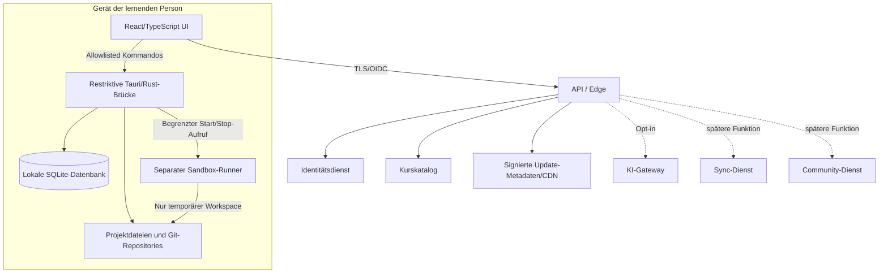

# DevPath – Technologievergleich und Architekturentscheidung

**Status:** Architekturvorschlag für Phase 1  
**Version:** 0.1  
**Stand:** 21. Oktober 2026  
**Entscheidungsart:** Vorläufige Auswahl, vor Produktionsstart durch Prototypen zu bestätigen  
**Bezug:** [DEVPATH_FOUNDATION.md](DEVPATH_FOUNDATION.md), [DEVPATH_THREAT_MODEL.md](DEVPATH_THREAT_MODEL.md), [DEVPATH_DESIGN_SPEC.md](DEVPATH_DESIGN_SPEC.md)

## 1. Zusammenfassung

### Vorläufige Empfehlung

Für die DevPath-Desktop-App wird **Tauri 2 mit TypeScript/React als UI und Rust als eng begrenzter nativer Diensteschicht** empfohlen. Das passt zur geplanten Web-ähnlichen Oberfläche und einem integrierten Editor, erlaubt eine kleine native Kontrollfläche und vermeidet, dass ein umfassender Node.js-Laufzeitkontext standardmäßig in der App verfügbar ist.

Diese Empfehlung ist **keine Sicherheitsgarantie**. Tauri reduziert bestimmte Angriffsflächen, liefert aber keine sichere Ausführungsumgebung für beliebigen Lerncode. Nutzer-Code muss in einer separaten, plattformspezifisch abgesicherten Sandbox laufen. Die Empfehlung gilt nur, wenn der Phase-1-Prototyp Updateverhalten, Editorleistung, Barrierefreiheit, Pluginreife und Builds auf allen Zielbetriebssystemen bestätigt.

### Vorgeschlagener Stack

| Bereich | Vorschlag | Begründung |
|---|---|---|
| Desktop-Shell | Tauri 2 | Native App-Hülle mit schmaler Rust-Brücke und Web-UI; Berechtigungen können granular modelliert werden. |
| UI | React + TypeScript + Vite | Passend zu Web-/Desktopteams, Designsystem und großem Ökosystem; Typprüfung und Komponentenmodell. |
| Editor | Monaco Editor, zunächst als eingebettete Editor-Komponente | Passt zur IDE-artigen Bedienung und Sprachunterstützung; Leistung und Lizenz müssen im konkreten Paketstand geprüft werden. |
| Native Brücke | Rust-Kommandos mit expliziter Allowlist | Dateiauswahl, OS-Keychain, Updateprüfung und Launcher; keine generische Shell- oder Dateisystem-API an den Renderer geben. |
| Lokale Daten | SQLite mit Schema-Versionierung; Projekte als normale Dateien/Git-Repositories | Portabel, lokal nutzbar, exportierbar; keine proprietäre Cloudbindung. |
| Codeausführung | Getrennter Sandbox-Runner je Plattform | Trennt beliebigen Lerncode von UI und privaten Daten; Framework-Shell ist kein Sandbox-Ersatz. |
| Website | React/TypeScript oder statische, serverseitig gerenderte Website | Kleine Angriffsfläche; Website bündelt Konto, Download und Information. |
| Backend | Modularer API-Dienst, PostgreSQL, Objektspeicher/CDN | Klare Trennung von Identität, Kurskatalog und optionalen Diensten; konkrete Anbieterwahl bleibt offen. |
| Authentifizierung | OIDC/OAuth-Flow mit Systembrowser und PKCE | Kein Clientgeheimnis; etablierter Standard und getrennte Identitätsverantwortung. |
| Observability | Strukturierte, datensparsame Logs und Metriken | Betriebsfähigkeit ohne standardmäßiges Erfassen von Quellcode/Prompts. |

## 2. Bewertungsmaßstab

Kriterien werden nach DevPath-Anforderungen gewichtet. Bewertung von 1 (ungünstig) bis 5 (günstig) ist eine qualitative Architekturabschätzung, kein Benchmark und keine Aussage zur Sicherheit einzelner Versionen.

| Kriterium | Gewicht | Warum es wichtig ist |
|---|---:|---|
| Windows/macOS/Linux und Releasefähigkeit | 20 % | Alle drei Plattformen sind Produktanforderung. |
| Sicherheit und Begrenzbarkeit der nativen Brücke | 20 % | App verarbeitet private Projekte und startet Codeausführung. |
| Editor- und Desktop-UI-Passung | 15 % | Code Studio ist ein zentrales Produktmerkmal. |
| Update-/Signierungsbetrieb | 15 % | Manipulierte Updates wären ein kritischer Schaden. |
| Barrierefreiheit und Plattformintegration | 10 % | Zielgruppe umfasst verschiedene Altersgruppen und Bedürfnisse. |
| Wartbarkeit und Ökosystem | 10 % | Kleine Teams müssen mehrere Plattformen langfristig pflegen. |
| Paketgröße und Ressourcenbedarf | 5 % | App soll für Lernende erreichbar und reaktionsschnell sein. |
| Lizenz- und Anbieterunabhängigkeit | 5 % | Langfristige Produktkontrolle und Kosten. |

## 3. Desktop-Framework-Vergleich

| Option | Stärken für DevPath | Kosten/Risiken | Einschätzung |
|---|---|---|---|
| **Tauri 2** | TypeScript-Web-UI plus native Rust-Schicht; granulare Capabilities; kleinerer Basiskern; passt zu Monaco und bestehender Webkompetenz. | WebView unterscheidet sich je OS; Linux-/Plugin- und Updatepfad müssen praktisch geprüft werden; Rust-Brücke ist sicherheitskritisch; Community-/Pluginqualität variiert. | **Empfohlen**, wenn Prototyp und sichere Sandboxlösung die Anforderungen erfüllen. |
| **Electron** | Reifes Web-Ökosystem, Chromium konsistent über Plattformen, viele Editor-/IDE-Beispiele und klare Sicherheitsdokumentation. | Größere Laufzeit und Angriffsfläche; Linux-Updatepfad muss separat gelöst werden; unsichere IPC-Konfiguration kann privilegierte Prozesse exponieren. | Starke Ausweichoption, falls Tauri-WebView oder Pluginreife die UX-/Accessibility-Ziele nicht erfüllt. |
| **Flutter Desktop** | Einheitliche gerenderte Oberfläche, offizielle Desktop-Zielplattformen und gute Kontrolle über visuelle Tokens. | Editorintegration und native Entwicklerwerkzeuge benötigen Zusatzarbeit; Pluginabdeckung unterscheidet sich je Betriebssystem; Team braucht Dart/Flutter-Kompetenz. | Geeignet, wenn konsistente Produktoberfläche wichtiger wird als Web-Editor-Ökosystem. |
| **Native App je OS** | Beste Plattformintegration und volle Kontrolle über OS-Funktionen. | Drei Implementierungen erhöhen Kosten, Funktionsabweichungen und Wartungsaufwand erheblich. | Für DevPaths erste Version nicht empfohlen. |

### Qualitative Nutzwertwertung

| Option | Cross-Plattform 20 | Sicherheit 20 | Editor 15 | Updates 15 | A11y/OS 10 | Wartbarkeit 10 | Ressourcen 5 | Kontrolle 5 | Gesamt / 5 |
|---|---:|---:|---:|---:|---:|---:|---:|---:|---:|
| Tauri 2 | 4 | 4 | 4 | 3 | 3 | 4 | 5 | 4 | 3.80 |
| Electron | 5 | 3 | 5 | 3 | 4 | 5 | 2 | 4 | 3.95 |
| Flutter | 4 | 4 | 3 | 3 | 4 | 4 | 4 | 4 | 3.70 |
| Native je OS | 5 | 4 | 4 | 4 | 5 | 2 | 4 | 4 | 4.00 |

Die Tabelle zeigt: Electron liegt im groben Gesamtscore ähnlich oder höher als Tauri. Tauri wird dennoch als **Prototyp-Hypothese** empfohlen, weil der schmale native Kontrollbereich und die Produktvorgabe „lokal zuerst“ gut zusammenpassen. Electron bleibt ernsthafte Ausweichoption. Ein nachgewiesener Sicherheits- oder UX-Vorteil ist erst nach Prototyp- und Releaseprüfungen belastbar.

## 4. Architekturvorschlag

### Komponentenverantwortung

- **UI/Renderer:** stellt Inhalte dar, validiert Eingaben für Bedienbarkeit, hat aber keine Autorität über Nutzeridentität oder serverseitige Berechtigungen.
- **Rust-Brücke:** kleine Liste typisierter Kommandos; führt keine beliebigen Shellbefehle aus und akzeptiert keine unbeschränkten Pfade. Dateizugriff erfolgt über Nutzerwahl oder Projektwurzel.
- **Lokale Datenbank:** hält Einstellungen, Lernpfad und Fortschritt; speichert keine Zugangsdaten. Migrationen sind versioniert und rückrollbar, Datenverlust wird vermieden.
- **Projektdateien:** bleiben reguläre, exportierbare Dateien. Private Code Base liegt lokal; Git kann über kontrollierten Prozess gestartet werden, wenn im Prototyp erforderlich.
- **Runner:** eigener Prozess/Benutzer/Container/VM pro Plattform mit minimalem Dateisystem, keinen App-Tokens, beschränkten Ressourcen und standardmäßig keinem Netzwerk.
- **Backend:** dient nur Onlinefunktionen. Keine Synchronisierung oder KI wird durch Framework automatisch aktiviert.

## 5. Backend- und Serverempfehlung

Für Phase 1 soll der Server als **modularer, versionierter API-Monolith** starten und keine Microservices voraussetzen. Logische Module werden getrennt gehalten:

1. Identitätsintegration und Kontoprofil
2. Kurskatalog und Veröffentlichungsmetadaten
3. Update-Feed und Downloadmetadaten
4. Diagnosedateneingang (nur mit Einwilligung)
5. später separat freizugebende KI-, Sync- und Communitymodule

**Datenhaltung:** relationale PostgreSQL-Datenbank für Konten/Metadaten; unveränderliche, signierte Kurs- und Updateartefakte in Objektspeicher/CDN. Keine Quellcodeablage im MVP-Backend. Produktions- und Entwicklungsumgebungen, Schlüssel und Daten sind strikt getrennt.

**Betriebsprinzipien:** Infrastructure as Code, getrennte Test-/Produktionskonten, minimale Service-Rollen, secret manager statt Env- oder Repositorygeheimnissen, Backups mit Restore-Übung, Metriken ohne Nutzinhalte, Kosten-/Ratenbegrenzung und nachvollziehbare Releasefreigabe.

Hostinganbieter, Region, Datenresidenz, SLA und Kosten werden erst nach Zielmarkt, Datenschutzprüfung und erwarteter Last gewählt. Kein Anbieter wird in diesem Dokument als beschlossen dargestellt.

## 6. Identität, Updates und sichere Kommunikation

### Identität

- Anmeldung im Systembrowser; OIDC Authorization Code mit PKCE, korrekter Redirect-Validierung und State/Nonce.
- Keine Clientgeheimnisse in Desktop-App oder öffentlichem Webbundle.
- Zugriffstoken kurzlebig; Refresh-Rotation/Widerruf und sichere Ablage im OS Credential Store.
- Lokales Lernen ohne Konto bleibt möglich, soweit keine Kontofunktion erforderlich ist.

### Updates

- Signierte Releaseartefakte und signierte/über TLS ausgelieferte Update-Metadaten.
- Schlüsselzugriff getrennt von Buildrunner; Releasefreigabe durch unabhängige Rolle.
- Versions-/Kanalmanifest, Hash, Mindestversion, Rolloutstatus und Widerrufsverfahren.
- Windows/macOS/Linux erhalten je ein dokumentiertes Paket- und Updateverfahren; ein Framework-Updater allein ist kein vollständiger Releaseprozess.
- Auf Linux Distributionen und Paketformate bewerten (z. B. AppImage/Flatpak/DEB/RPM) und nur tatsächlich unterstützte Formate zusagen.

## 7. Code Studio: Editor und Ausführung getrennt behandeln

Monaco ist als Startpunkt für den Editor vorgesehen, aber nicht als Ausführungsumgebung. Editor, LSP/Analyse, Aufgabe und Runner werden getrennt betrachtet.

### Ausführungsstufen

1. **MVP-Aufgaben:** vorgefertigte, lokale Ausführung in Runner mit Netzwerk aus und temporärem Workspace.
2. **Mehrsprachige Kurse:** pro Sprache eine gepflegte Runtime-Image-/Toolchain-Version, Ressourcenlimits und reproduzierbarer Aufgabenstart.
3. **Communitycode:** zunächst nur Download/Ansicht; lokale Ausführung erfolgt ausschließlich nach expliziter Handlung und in derselben oder strengeren Sandbox.

### Plattformstrategie

- Windows: AppContainer/Windows Sandbox oder eine bewertete, verfügbare Isolationslösung; Job Objects allein sind keine vollständige Dateisystem-Sandbox.
- macOS: App Sandbox/entitlements bzw. separater, minimal berechtigter Runner; Signierung und Notarisierung in Releaseprozess einplanen.
- Linux: Namespaces/seccomp/cgroups über etablierte Runtime oder Bubblewrap/OCI-Container mit minimalem Profil; Verfügbarkeit und Benutzerkonfiguration testen.

Die konkrete Implementierung ist offen, bis Plattformprototypen beweisen, dass Isolation ohne Adminrechte installierbar, wartbar und für Einsteiger verständlich ist. Falls eine Plattform die Mindestgrenze nicht erfüllt, wird dort Codeausführung deaktiviert oder klar eingeschränkt statt ungeschützt ausgeführt.

## 8. Lizenz-, Wartungs- und Lieferkettenregeln

- Vor Einbindung von Framework, Monaco, Syntaxpaketen, Sprachservern und Runtime-Images wird Lizenzinventar samt Version und Lizenztext geführt.
- Release erzeugt SBOM und prüft bekannte Schwachstellen und Lizenzbedingungen.
- Abhängigkeiten sind versioniert und reproduzierbar aufgelöst; Updates werden kontrolliert eingespielt.
- Plugins werden nicht beliebig zur Laufzeit nachgeladen. Erweiterbarkeit folgt Allowlist und Sicherheitsprüfung.
- Buildprovenance, Quellrevision und Artefakthash sind für jede freigegebene Version nachvollziehbar.
- Kritische Sicherheitsupdates und Supportende jeder Laufzeit/Abhängigkeit haben Verantwortliche und Prozess.

## 9. Phase-1-Prototyp und Entscheidungstore

Bevor die Frameworkwahl als verbindlich gilt, wird ein vertikaler Prototyp gebaut. Das ist keine vollständige Produktimplementierung; er prüft die größten Annahmen.

### Prototypumfang

- App-Hülle mit Navigation aus der Design-Spezifikation.
- Monaco oder gleichwertiger Editor mit einer kleinen Übung.
- Lokales Profil und SQLite-Migration.
- Datei öffnen/speichern über begrenzte Rust-Kommandos.
- Eine erste Ausführung in isoliertem Runner auf allen Zielbetriebssystemen.
- Signierter Testbuild und Updateprüfung mit mindestens einem Testkanal.
- 200-%-Textskalierung, Tastaturbedienung und Screenreader-Smoke-Review.

### Entscheidungstore

| Tor | Bestehenskriterium | Wenn nicht erfüllt |
|---|---|---|
| G1 Plattformaufbau | CI kann Windows, macOS und Linux reproduzierbar bauen; Pakete starten auf unterstützten Mindestversionen. | Framework/Releaseprozess neu bewerten. |
| G2 Editor/UX | Editor reagiert bei Pilotprojekt ohne störende Verzögerung; Kernbedienung per Tastatur möglich. | Monaco-Konfiguration oder Framework vergleichen; ggf. Electron/Flutter-Prototyp. |
| G3 Brückensicherheit | Renderer besitzt keine generische Shell-/Dateisystemrechte; Kommandos sind typisiert und begrenzt. | Tauri-Konfiguration/IPC überarbeiten oder Option neu bewerten. |
| G4 Runner-Isolation | Netzwerk und fremde Hostdateien sind in Angriffsszenarien unerreichbar; harte Ressourcenlimits greifen. | Keine Codeausführung freigeben; Runner neu entwerfen. |
| G5 Updates | Signatur wird vor Installation geprüft; manipuliertes/älteres nicht zulässiges Paket wird abgewiesen. | Releaseverfahren nicht produktiv nutzen. |
| G6 Barrierefreiheit | Navigation, Fokus, Einstellungen und Übung sind bei Textskalierung und Screenreader verständlich. | Interaktionsmodell oder UI-Stack anpassen. |
| G7 Lizenz/Abhängigkeiten | Lizenzinventar und SBOM erzeugbar; Komponentenstatus geklärt. | Keine Veröffentlichung des betroffenen Pakets. |

## 10. Risiken und offene Annahmen

1. **Tauri-WebView-Differenzen:** WebView2, WKWebView und WebKitGTK können Rendering, Editorverhalten und APIs unterschiedlich behandeln. Die App muss auf jeder Zielplattform real geprüft werden.
2. **Linux-Paketfragmentierung:** Distribution, WebKitGTK-Version und Installationsweg beeinflussen Supportaufwand.
3. **Sandboxaufwand:** Sichere Codeausführung auf drei Desktopbetriebssystemen ist ein eigenes Sicherheitsprojekt und kann die erste Ausbaustufe begrenzen.
4. **Editorgröße und Lizenz:** Paketgröße und Lizenzbedingungen aller Monaco-Komponenten/Erweiterungen sind vor Release zu prüfen.
5. **Updateverantwortung:** Framework-Updater löst weder Schlüsselverwaltung noch Rollbackpolitik, Incidentreaktion und Linux-Verteilung vollständig.
6. **Backendanbieter:** Region, Auftragsverarbeitung, Unterauftragnehmer und Betriebszugriff sind noch nicht ausgewählt.
7. **Identitätsmodell:** Konto optional für Offline-Lernen; Kontowiederherstellung und minderjährige Nutzer benötigen konkrete Produkt- und Rechtsentscheidung.
8. **Kosten:** Externe KI, Egress und Communityspeicher können Kosten dominieren; optionale Dienste brauchen Budgets und Limits.

## 11. Beschlussvorschlag

1. **Tauri 2 + React + TypeScript** wird als Desktopprototyp untersucht.
2. **Electron** bleibt gleichwertiger Rückfallkandidat, insbesondere bei WebView-/Accessibilityproblemen oder Updatevorteilen.
3. **Flutter** bleibt Alternative, falls einheitliches Rendering und plattformübergreifende UI wichtiger werden als Web-Editor-Ökosystem.
4. **Backend startet modular als Monolith**, PostgreSQL für Metadaten, Objektspeicher/CDN für signierte unveränderliche Artefakte; Hostinganbieter bleibt offen.
5. **OIDC/OAuth mit PKCE** ist die Vorgabe für Anmeldung; konkreter Anbieter bleibt offen.
6. **Codeausführung bleibt getrennt und wird erst nach G4 je Plattform freigegeben.** Tauri-, Electron- oder Flutter-Prozessisolation ersetzt die Runner-Sandbox nicht.
7. Nach den Entscheidungstoren werden Wertung, Einschränkungen, Versionen und Anbieterwahl aktualisiert und als Architecture Decision Record (ADR) beschlossen.

## 12. Quellen (Primärdokumentation)

- [Tauri 2 – Security](https://v2.tauri.app/security/)
- [Tauri 2 – Capabilities](https://v2.tauri.app/security/capabilities/)
- [Tauri 2 – Updater plugin](https://v2.tauri.app/plugin/updater/)
- [Electron – Security](https://www.electronjs.org/docs/latest/tutorial/security)
- [Electron – Process Sandboxing](https://www.electronjs.org/docs/latest/tutorial/sandbox)
- [Electron – autoUpdater API](https://www.electronjs.org/docs/latest/api/auto-updater)
- [Flutter – Desktop support](https://docs.flutter.dev/platform-integration/desktop)
- [Flutter – Platform integration](https://docs.flutter.dev/platform-integration)
- [OWASP – ASVS](https://owasp.org/www-project-application-security-verification-standard/)
- [OWASP – API Security Top 10](https://owasp.org/www-project-api-security/)
- [IETF – OAuth 2.0 Security Best Current Practice, RFC 9700](https://www.rfc-editor.org/rfc/rfc9700)

Dokumentationsstände und genaue Funktionsverfügbarkeit können sich ändern. Vor Implementierung werden die jeweils aktuellen offiziellen Dokumente, Pluginversionen, Betriebssystemunterstützung und Lizenzbedingungen erneut geprüft.
