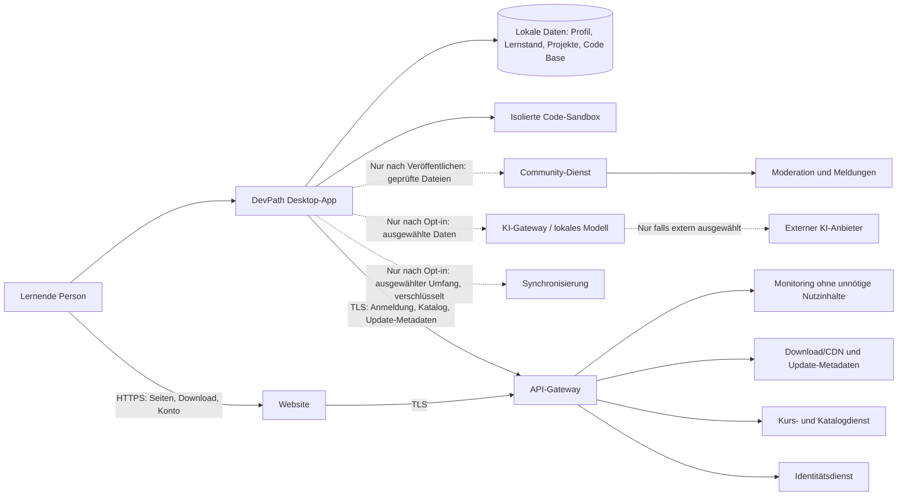
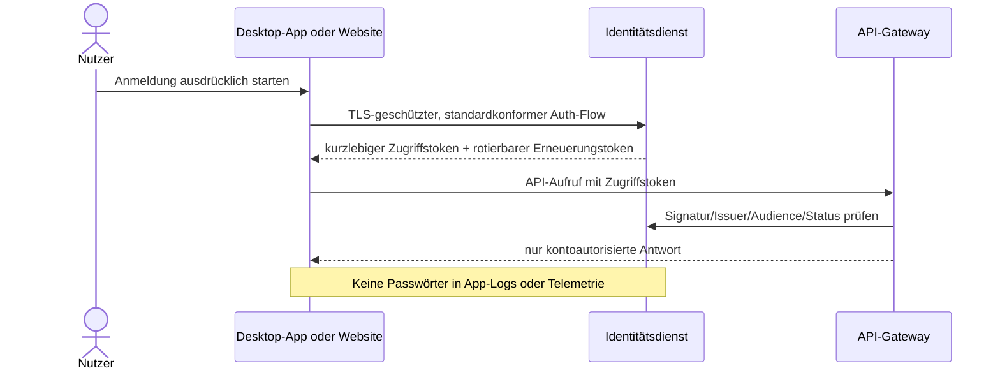
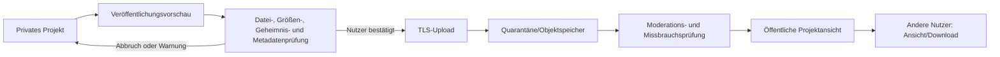

# DevPath – Bedrohungsmodell und Datenflüsse

**Status:** Arbeitsgrundlage für Phase 1  
**Version:** 0.1  
**Stand:** 21. Oktober 2026  
**Geltungsbereich:** Website, Desktop-Clients für Windows/macOS/Linux und Backenddienste  
**Bezug:** [DEVPATH_FOUNDATION.md](DEVPATH_FOUNDATION.md)

> Dieses Dokument ist ein lebendes Architekturartefakt, kein Sicherheitszertifikat und keine Rechtsberatung. Risiken sind auf Produkt- und Architekturhöhe beschrieben. Vor öffentlichem Betrieb sind konkrete Hosting-, Identitäts-, Update- und Laufzeitlösungen zu prüfen und unabhängigen Sicherheitsprüfungen zu unterziehen.

## 1. Zweck und Sicherheitsziele

Das Modell legt fest, welche Informationen DevPath verarbeitet, wo Vertrauensgrenzen liegen, was geschützt werden muss und welche Architekturregeln aus den Bedrohungen folgen. Es ist so formuliert, dass spätere Dienste ergänzt werden können, ohne lokale Lern- und Codefunktionen unnötig vom Backend abhängig zu machen.

### Sicherheitsziele

1. **Quellcode und lokale Projekte bleiben privat**, außer Nutzer veröffentlichen oder synchronisieren sie ausdrücklich.
2. **Konten und Sitzungen sind vor Übernahme geschützt.** Eine kompromittierte Sitzung darf keine Rechte außerhalb des Kontos erhalten.
3. **Codeausführung ist begrenzt und isoliert.** Aufgaben- und Communitycode darf weder Hostdaten lesen noch unbemerkt Netzwerkzugriff erhalten.
4. **Updates sind authentisch und rückverfolgbar.** Der Client installiert nur freigegebene, signierte Artefakte.
5. **KI-Datenflüsse sind sichtbar und begrenzt.** Nur ausgewählte Inhalte werden für eine konkrete Anfrage verarbeitet.
6. **Onlinefunktionen sind optional und getrennt.** Ein Ausfall oder eine Kompromittierung eines Onlinebereichs legt lokale Projekte nicht offen.
7. **Lernende behalten Kontrolle.** Datenverarbeitung, Teilen, Synchronisieren und KI-Nutzung sind verständlich einstellbar und widerrufbar.
8. **Missbrauch ist erkennbar und behandelbar.** Sicherheitsereignisse können untersucht werden, ohne unnötig Quellcode oder vollständige Lernhistorien zu sammeln.

### Nichtziele

- Schutz vor einem bereits vollständig kompromittierten Gerät oder vor administrativem Zugriff durch dessen Eigentümer.
- Garantie, dass von einem externen KI-Anbieter gelieferter Inhalt korrekt oder sicher ist.
- Behauptung vollständiger Anonymität beim Download, bei Anmeldung oder bei Communityveröffentlichung.
- Ersatz für rechtliche Prüfung, Datenschutz-Folgenabschätzung, Penetrationstest oder Incident-Response-Übung.

## 2. Systemkontext und Schutzgüter

### Komponenten

- **Öffentliche Website:** Produktinformationen, Downloadverweise, Kontooberfläche und Support. Sie führt selbst keinen Nutzercode aus.
- **Desktop-App:** Lernoberfläche, Lernplan, Einstellungen, Editor und lokale Datenverwaltung.
- **Lokaler Speicher:** Profileinstellungen, Kurscache, Fortschritt, Projekte, Git-Repositories und lokale Versionen. Speicherung ist standardmäßig an das Betriebssystemkonto gebunden.
- **Laufzeit-Sandbox:** Führt Lernaufgaben und später ausgewählte Projekte mit begrenzten Rechten aus.
- **API-Gateway:** Einziger öffentlicher Einstieg für App- und Web-API-Aufrufe; erzwingt Transport-, Größen-, Raten- und Protokollgrenzen.
- **Identitätsdienst:** Konto, Anmeldung, Sitzungs- und Wiederherstellungsabläufe.
- **Kurs- und Update-Dienst:** Signierte, versionierte Kursmetadaten und Updatekanäle; liefert unveränderliche Artefakte aus einem CDN oder Objektspeicher.
- **Optionale Synchronisierung:** Überträgt nur den ausdrücklich gewählten Datenumfang zwischen Geräten.
- **Optionale KI-Gateway-/Modellkomponente:** Verarbeitet nur ausgewählte Anfrageinhalte; kann lokal oder über einen transparent ausgewiesenen Anbieter betrieben werden.
- **Community-Dienst:** Speichert ausdrücklich veröffentlichte Projekte und Interaktionen; stellt Inhalte als nicht vertrauenswürdig dar.
- **Betriebsdienste:** Geheimnisverwaltung, Protokollierung, Alarmierung, Backups und administrative Zugänge.

### Schutzgüter

| Schutzgut | Vertraulichkeit | Integrität | Verfügbarkeit |
|---|---:|---:|---:|
| Quellcode, private Projekte und lokale Historie | Hoch | Hoch | Mittel |
| Kontodaten, Wiederherstellungs- und Sitzungsdaten | Hoch | Hoch | Hoch |
| Lernstand und Lernverhaltenssignale | Hoch | Hoch | Mittel |
| Signierschlüssel und Updatefreigaben | Sehr hoch | Sehr hoch | Hoch |
| Veröffentlichte Communityinhalte und Moderationsdaten | Mittel bis hoch | Hoch | Mittel |
| KI-Anfragen und Modellantworten | Hoch | Mittel | Niedrig bis mittel |
| Kursinhalte und Katalogmetadaten | Niedrig bis mittel | Hoch | Mittel |
| Betriebsgeheimnisse, Backups und Adminzugänge | Sehr hoch | Sehr hoch | Hoch |

## 3. Datenklassen und Vertrauensgrenzen

### Datenklassen

- **D0 – öffentlich:** Marketingseiten, öffentliche Kursbeschreibungen, öffentliche Communityprojekte.
- **D1 – internes Produktmaterial:** nicht veröffentlichte Kursentwürfe, Betriebsmetadaten, nicht geheime Diagnoseinformationen.
- **D2 – persönliche Daten:** Konto, Einstellungen, Lernziele, Fortschritt, Nutzungs- und Supportdaten.
- **D3 – vertraulicher Nutzinhalt:** private Quelltexte, Projektdateien, lokale Versionsgeschichte, KI-Anfragen, private Synchronisationsdaten.
- **D4 – Sicherheitsgeheimnisse:** Passworthashes/Identitätsgeheimnisse, Sitzungstoken, API-Schlüssel, Signier- und Verschlüsselungsschlüssel.

### Vertrauensgrenzen

1. **T1 – Internet zu Website/CDN:** Downloads und Seiteninhalt sind potenziell manipulierbar, bis TLS, Signatur und lokale Verifikation geprüft wurden.
2. **T2 – Client zu API:** Der Client ist nicht vertrauenswürdig. API-Parameter können gefälscht, wiederholt oder automatisiert gesendet werden.
3. **T3 – Clientprozess zu lokalem Nutzercode:** Nutzercode ist nicht vertrauenswürdig und darf nicht mit Rechten des App-Prozesses ausgeführt werden.
4. **T4 – Backenddienst zu Backenddienst:** Dienstidentität und minimale Berechtigung sind erforderlich; internes Netzwerk gilt nicht automatisch als vertrauenswürdig.
5. **T5 – DevPath zu externem KI-Anbieter:** Nutzerinhalt verlässt den kontrollierten Bereich. Anbieter, Datenverwendung, Aufbewahrung und Region müssen vor der Anfrage benannt sein.
6. **T6 – privat zu öffentlich in Community:** Veröffentlichung ist ein expliziter Zustandswechsel mit Vorschau, Metadatenprüfung und klarer Sichtbarkeit.
7. **T7 – Nutzergerät zu synchronisiertem Cloudspeicher:** Synchronisierung schafft eine zusätzliche Kopie und ein weiteres Angriffsziel.
8. **T8 – Build-/Releaseumgebung zu Updatekanal:** Buildsystem, Freigabe und Signierung bilden eine besonders kritische Vertrauenskette.

## 4. Datenflussdiagramme

### 4.1 Übersicht



Durchgezogene Onlinepfade sind Kernpfade für Website, Anmeldung, Kursmetadaten und Updates. Gestrichelte Pfade sind optionale Funktionen und standardmäßig nicht aktiv. Lokales Lernen und private Code Base sollen ohne diese optionalen Pfade weiter nutzbar sein.

### 4.2 Anmeldung und Konto



Die konkrete Anmeldung soll einen etablierten OAuth-2.1-/OpenID-Connect-Flow mit Systembrowser und PKCE verwenden, sofern die gewählte Identitätsplattform dies sicher unterstützt. Keine eingebetteten Clientgeheimnisse. Tokens werden kurzlebig gehalten; Erneuerungstokens rotieren, werden widerrufbar gespeichert und sind an sichere Betriebssystemspeicher gebunden. Die App soll keinen eigenen Passwortspeicher implementieren.

### 4.3 KI-Anfrage (optional)

```mermaid
sequenceDiagram
    actor U as Nutzer
    participant A as App / Editor
    participant P as lokale Datenschutzvorschau
    participant K as KI-Gateway oder lokales Modell
    participant X as externer Anbieter (optional)
    U->>A: konkrete Hilfe anfordern
    A->>P: Anfrageentwurf + ausgewählte Ausschnitte
    P-->>U: Umfang, Ausführungsort, Anbieter und Lösch-/Aufbewahrungshinweis
    U->>P: bestätigen oder abbrechen
    alt lokal
        P->>K: nur ausgewählter Inhalt
    else extern bestätigt
        P->>K: minimierte Anfrage über TLS
        K->>X: nur notwendige Inhalte, keine App-Geheimnisse
        X-->>K: Modellantwort
    end
    K-->>A: Erklärung/Hinweis als untrusted content
    A-->>U: Antwort anzeigen; Änderungen nur als Vorschlag mit Zustimmung
```

### 4.4 Communityveröffentlichung



Communityinhalte sind nach Veröffentlichung öffentlich oder für den ausdrücklich gewählten Kreis zugänglich. Private Repositoryhistorie, versteckte Dateien, lokale Pfade und Zugangsdaten werden nicht standardmäßig hochgeladen. Downloads bleiben nicht vertrauenswürdige Dateien und werden nicht automatisch ausgeführt.

## 5. Bedrohungsanalyse

Priorisierung: **Kritisch** = kann Konten, Updatekette oder vertraulichen Code übergreifend kompromittieren; **Hoch** = erheblicher Datenschutz-/Sicherheitsimpact; **Mittel** = begrenzter oder stärker eingrenzbarer Impact. Prioritäten sind vor Produktionsfreigabe anhand realer Architektur und Bedrohungswahrscheinlichkeit zu validieren.

| ID | Bedrohung / Missbrauchsszenario | Risiko | Mindestanforderungen / Kontrolle |
|---|---|---|---|
| R1 | Manipulierter Installer oder kompromittierter Updatekanal installiert Schadcode. | Kritisch | Signierte Artefakte; Schlüssel offline oder in HSM; getrennte Build- und Freigaberechte; Manifest mit Hash, Version und Kanal; Client prüft Signatur vor Installation; Schutz vor Downgrade; Notfall-Widerruf/Rotation dokumentieren. |
| R2 | Bösartiger oder fehlerhafter Code liest Hostdateien, stiehlt Tokens oder erschöpft Ressourcen. | Kritisch | Keine Ausführung im App-Prozess; Sandbox mit separatem Benutzer/Container/VM je Plattform, read-only Basis, temporärem Workspace, CPU/RAM/Prozess-/Zeitlimits; Netzwerk aus; kein Zugriff auf Home, Browserprofil, IPC oder Agent-Sockets; Sandbox-Escape-Tests vor Freigabe. |
| R3 | API vertraut Clientangaben oder IDs und erlaubt Zugriff auf fremdes Konto/Projekt. | Hoch | Autorisierung serverseitig für jedes Objekt; keine bloße UI-Prüfung; standardmäßig verweigern; Mandantentrennung; positive und negative Berechtigungstests; Rate Limits. |
| R4 | Phishing, Credential Stuffing oder gestohlener Token übernimmt Konto. | Hoch | OIDC mit PKCE, MFA-Option, Ratenbegrenzung und Schutz gegen bekannte kompromittierte Passwörter beim Anbieter; Tokenrotation/Widerruf; Geräte-/Sitzungsverwaltung; Wiederherstellung ohne schwache Sicherheitsfragen. |
| R5 | Lokale Datenbank oder Backups legen Lernverlauf und private Projekte offen. | Hoch | OS-Konto-ACLs; Verschlüsselung sensibler lokaler Metadaten und optionaler Geräteschlüssel im OS-Keychain; keine Geheimnisse im Klartext; Export/Löschung; Backups standardmäßig nur lokale OS-Sicherung. Beachten: lokale Vollplattenverschlüsselung ist Voraussetzung gegen ausgeschaltetes Gerät. |
| R6 | KI-Anfrage enthält versehentlich Zugangsdaten, private Dateien oder mehr Code als nötig. | Hoch | Kontext nur explizit ausgewählt; Secret-Scanner mit Warnung; Vorschau von Inhalt und Empfänger; Opt-in; lokale KI als Option; kein Training/Retention durch Anbieter vertraglich prüfen; keine Prompts, Quelltexte oder Antworten in App-Logs. |
| R7 | Prompt-Injection im Repository oder Kursinhalt bringt KI dazu, Daten preiszugeben oder gefährliche Schritte zu empfehlen. | Hoch | Projektdateien und Kursmaterial als nicht vertrauenswürdige Daten kennzeichnen; KI darf keine eigenmächtigen Tools/Datei-/Netzwerkaktionen ausführen; Toolrechte getrennt; Ausgabe als Vorschlag; Sicherheitsfilter und Nutzerbestätigung. |
| R8 | Communityupload enthält Malware, Geheimnisse, schädliche Links oder missbräuchliche Inhalte. | Hoch | Uploadvorschau, Größen-/Dateitypgrenzen, Metadaten- und Secret-Scan, Quarantäne, Meldung/Moderation, Downloadwarnung und niemals automatische Ausführung. |
| R9 | Cross-Site Scripting, CSRF oder Kontoübernahme über die Website. | Hoch | Strikte CSP, sichere Cookieattribute, CSRF-Schutz, Output-Encoding, dependency scanning, sichere OAuth-Weiterleitungen, keine Tokens in URL/localStorage, Security-Header und regelmäßige DAST-Prüfung. |
| R10 | Supply-chain-Angriff auf Abhängigkeit, Buildrunner oder Entwicklerkonto. | Kritisch | Abhängigkeitsinventar/SBOM, feste Versionen und Lockfiles, Herkunftsprüfung, minimale CI-Berechtigungen, kurzlebige Buildidentitäten, geschützte Releasefreigabe, reproduzierbare Builds soweit erreichbar, signierte Provenance/Artefakte. |
| R11 | Service- oder KI-Kosten werden durch automatisierte Anfragen/DoS unkontrolliert erhöht. | Mittel bis hoch | Rate- und Kontingentlimits pro Konto/IP/Funktion, Größen- und Zeitlimits, Queue/Backpressure, Kostenalarme und Notabschaltung; öffentliche Inhalte über CDN. |
| R12 | Lernverhaltensdaten werden für Profiling, Werbung oder unpassende Wertung zweckentfremdet. | Hoch | Zweckbindung, Datensparsamkeit, transparente Empfehlungen, lokale Verarbeitung bevorzugen, getrennte Einwilligung, Export/Löschung und keine Ranglisten standardmäßig. |
| R13 | Synchronisierung überschreibt Daten oder legt privat gedachte Inhalte unerwartet offen. | Hoch | Explizite Auswahl, Ende-zu-Ende-Verschlüsselung prüfen, Konfliktkopien statt stiller Überschreibung, Versionshistorie, Gerätewiderruf, Upload-/Löschvorschau. |
| R14 | Admin- oder Supportzugang wird missbraucht und öffnet Nutzerinhalte. | Hoch | Just-in-time-Zugriff, MFA, Vier-Augenfreigabe für kritische Aktionen, eng begrenzte Rollen, nachvollziehbare Auditlogs, keine standardmäßige Supporteinsicht in Quellcode. |
| R15 | Protokolle/Crashberichte sammeln Code oder Zugangsdaten. | Hoch | Allowlist strukturierter Felder, Redaktion sensibler Strings, keine Request-Bodies/Editorinhalte, begrenzte Aufbewahrung, Zugriffsbeschränkung und Stichprobenprüfung der Redaktionsregeln. |
| R16 | Minderjährige werden durch öffentliche Interaktion, Direktnachrichten oder geteilte Metadaten gefährdet. | Hoch | Community im Pilot deaktiviert; vor Start Alters-/Rechtskonzept, Privatsphäre-Voreinstellungen, Melde-/Blockier-/Moderationsabläufe, Kontakt- und Direktnachrichtenregeln und Schutz gegen Auffinden persönlicher Daten. |

## 6. Sicherheits- und Datenschutzanforderungen nach Komponente

### Desktop-App und lokale Daten

- Standardmäßig werden nur Kursinhalte und notwendige Metadaten abgerufen; keine Projekte ohne Nutzerhandlung hochladen.
- Lokaler Speicher erhält klare ACLs und Versionsmigrationen. Beschädigte Datenbank darf keine stillen Datenverluste verursachen.
- Anwendung aktualisiert sich nur über signierte Kanäle; manuelle Offlineprüfung der Herausgeberidentität bleibt möglich.
- Deeplinks, Dateizuordnungen und importierte Archive werden als nicht vertrauenswürdige Eingaben validiert.
- Secrets und Tokens in Windows Credential Manager, macOS Keychain oder Linux Secret Service speichern; kein Klartext-Fallback ohne sichtbare Warnung.
- Ein Absturzbericht ist lokal einsehbar und wird erst nach Nutzerfreigabe übertragen.

### Website und Konto

- Authentifizierung über etablierten Anbieter bzw. geprüften OIDC-Provider; keine eigene Passwortkryptografie ohne zwingenden Grund.
- Websitzungen mit `HttpOnly`, `Secure`, geeignetem `SameSite`, kurzer Laufzeit und CSRF-Schutz.
- E-Mail-Verifikation und sichere Wiederherstellung; Rücksetzlinks kurzlebig und einmalig.
- Schutz gegen Kontoenumeration, automatisierte Anmeldung, CSRF, XSS und offene Redirects.
- Downloadseite bindet signierte Releases an nachvollziehbare Versions-/Hashinformationen.

### API und Backend

- API versioniert; Schema validiert Typen, Größen, Pfade und Enumerationen serverseitig.
- Autorisierung pro Aktion und Objekt, getrennt von Authentifizierung.
- Service-zu-Service-Identitäten, Least Privilege, Netzwerksegmentierung und rotierbare Geheimnisse.
- Keine direkten Datenbankzugriffe aus öffentlichen Komponenten; restriktive Egress-Regeln.
- Idempotente schreibende Aktionen, Replay-Schutz für sensible Abläufe und Rate Limits.
- Logs enthalten Korrelations-ID und Ergebnisstatus, aber keine Tokens, vollständigen Prompts oder Quelltexte.

### KI-Dienst

- Modellanbieter wird vor Nutzung pro Funktion ausgewiesen; Region, Aufbewahrung, Trainingsnutzung und Unterauftragnehmer sind Entscheidungskriterien.
- Eingabeumfang bleibt sichtbar und editierbar. Verdeckte Kontextsammlung aus gesamten Repositories ist ausgeschlossen.
- Antworten sind untrusted content; kein direktes Ausführen von Code oder Werkzeugaufrufen.
- Pro Anfrage können lokale Verarbeitung und externe Verarbeitung unterschieden und deaktiviert werden.
- Modellwechsel und Fallbacks dürfen Datenschutzwahl nicht stillschweigend ändern.

### Updates und Softwarelieferkette

- Entwicklungs-, Test- und Produktionssignierung sind getrennt.
- Schlüsselmaterial ist nicht in normalen Entwicklerkonten oder CI-Logs verfügbar.
- Release benötigt mindestens unabhängige Freigabe und dokumentierten Build-Commit.
- Manifeste enthalten Plattform, Version, Mindestversion, Hash, Signatur und Rolloutkanal.
- Rollback erfolgt nur auf bekannte, weiterhin sichere Releases; Mindestversion kann bei kritischen Schwachstellen erzwungen werden.
- Widerrufs- und Schlüsselrotationsverfahren werden geübt, bevor Nutzerbasis groß ist.

## 7. Datenschutz-Lebenszyklus

| Phase | Regel |
|---|---|
| Erhebung | Daten nur bei konkreter Funktion, mit verständlichem Zweck und minimalem Umfang erheben. |
| Nutzung | Lernsignale nur zur Anpassung des Lernangebots nutzen; keine verdeckte Bewertung oder Werbeprofilbildung. |
| Übermittlung | Verschlüsselt, nur an notwendige Empfänger; externe KI und Synchronisierung separat und ausdrücklich aktivierbar. |
| Speicherung | Zweckgebundene Fristen je Datentyp; private Projekte lokal, sofern Nutzer keine Übertragung startet. |
| Zugriff | Rollenbasiert, zeitlich begrenzt und protokolliert; Support sieht standardmäßig keine privaten Projekte. |
| Export | Lokale Projekte, Fortschritt und Kontodaten in dokumentiertem Format exportierbar. |
| Löschung | Konto- und Cloudlöschung löst Löschung aktiver Kopien und zeitgebundene Entfernung aus Backups aus; Status wird erklärt. |
| Änderung des Zwecks | Erfordert erneute Prüfung und gegebenenfalls neue Zustimmung; keine stille Erweiterung. |

## 8. Betrieb und Reaktion auf Vorfälle

Vor öffentlicher Beta sind folgende Abläufe einzurichten:

1. Sicherheitskontakt und vertraulicher Meldeweg mit internem Verantwortlichen.
2. Schweregradmodell und Bereitschaftsverantwortung.
3. Verfahren für Token-, Schlüssel- und Zertifikatswiderruf.
4. Verfahren zur Sperrung schädlicher Downloads, Kurse, Communityobjekte und KI-Integrationen.
5. Beweissicherung mit Zugriffskontrolle und minimierter Erhebung.
6. Kommunikationsplan für Nutzer, Hostinganbieter und zuständige Stellen nach erforderlicher Rechtsprüfung.
7. Wiederherstellung aus Backups und Nachweis, dass kompromittierte Geheimnisse rotiert wurden.
8. Regelmäßige Tabletop-Übung mindestens vor breiter Veröffentlichung und nach wesentlichen Architekturänderungen.

## 9. Architekturentscheidungen, die vor dem Prototypen festzulegen sind

| Entscheidung | Sicherheitswirkung | Vorläufige Leitlinie |
|---|---|---|
| Desktop-Framework und Updateverfahren | Prozessisolation, Angriffsfläche und Signierung unterscheiden sich | Auswahl anhand verfügbarer Sandbox-/Updatekontrollen, Plattformabdeckung und Lizenz; nicht nur nach UI-Geschwindigkeit |
| Ausführungs-Sandbox pro OS | Größte lokale technische Risikofläche | Sicherheitsmodell je Plattform dokumentieren; keine gemeinsame ungeschützte Ausführungslösung |
| Identitätsanbieter | Sitzungen, MFA, Wiederherstellung und Betriebsdaten | Standardprotokoll OIDC/OAuth mit PKCE und Anbieterprüfung |
| Hostingregion und Betreiber | Datenschutz, Zugriff und Wiederherstellung | Zielmarkt und Datenklassen vor Anbieterauswahl festlegen |
| Lokale Verschlüsselung | Schutz bei Gerätediebstahl, aber Schlüsselverwaltung komplex | OS-Keychain/Secret Store und Vollplattenverschlüsselung berücksichtigen; Bedrohungsgrenze offen erklären |
| KI-Modell und Anbieter | Code kann geistiges Eigentum oder Geheimnisse enthalten | Lokale Option und getrennte externe Einwilligung; keine Anbieterwahl vor Vertrags-/Datenprüfung |
| Community-Sichtbarkeit | Öffentliche Daten und Moderationspflicht | Nicht im Pilot; einfache, klare Sichtbarkeitsstufen später prüfen |
| Sync-Verschlüsselung | Serverbetreiberzugriff gegen Wiederherstellbarkeit | E2E-Verschlüsselung prüfen; Wiederherstellungsfolgen und Mehrgerätefluss prototypisieren |

## 10. Verifikationsplan

Keine Produktionsfreigabe ohne passende Prüfungen. Die konkrete Prüftiefe hängt vom ausgewählten Stack ab.

- **Architektur:** Datenflussdiagramm und Threat review bei jeder neuen externen Datenverarbeitung.
- **API:** automatisierte Autorisierungs- und Mandantentrennungstests, Schema-/Fuzztests und Rate-Limit-Prüfung.
- **App:** Signaturprüfung, Update-Downgrade-/Rollbackprüfung, sichere Speicherung von Tokens und Deep-Link-/Importvalidierung.
- **Sandbox:** Escape-, Ressourcenerschöpfungs-, Dateizugriffs- und Netzwerktests für jede unterstützte Plattform.
- **Web:** Security-Header, CSP, Cookie-/CSRF-/XSS-Prüfung und Dependency-Scan.
- **Lieferkette:** SBOM, Lizenzprüfung, Geheimnisscan und Herkunftsnachweis für Releases.
- **Datenschutz:** Test, dass Opt-out tatsächlich keine entsprechende Anfrage sendet; Export- und Löschabläufe nachvollziehen.
- **Betrieb:** Backup-Restore, Widerruf/Rotation und Incident-Response-Übung.
- **Unabhängige Prüfung:** Externe Penetrationsprüfung vor breitem öffentlichen Start und nach wesentlichen Architekturänderungen.

## 11. Restrisiken und Freigabekriterien

Einige Risiken lassen sich nicht allein durch Dokumentation beseitigen: kompromittierte Endgeräte, unbekannte Sandbox-Escapes, Fehler externer Modelle, Missbrauch öffentlicher Inhalte und Schwachstellen in Abhängigkeiten bleiben möglich. Vor einer breiten Veröffentlichung müssen konkrete Restrisiken durch verantwortliche Personen akzeptiert und Maßnahmen mit Frist versehen werden.

**Freigabeblocker für öffentliche Beta:**

- Updateartefakte sind nicht signaturgeprüft.
- Nutzercode läuft mit denselben Rechten wie die Haupt-App.
- API prüft Objektberechtigungen nicht serverseitig.
- KI- oder Sync-Übertragung ist ohne klare Nutzerhandlung aktiv.
- Backup- und Schlüsselwiederherstellung sind nicht dokumentiert.
- Community öffnet Uploads automatisch oder besitzt keinen Meldungs-/Moderationsweg.
- Minderjährigenzugang oder öffentliche Interaktion ist ungeprüft freigeschaltet.

## 12. Änderungsprozess

Dieses Modell wird aktualisiert, wenn neue Datenklassen, externe Anbieter, Plattformfunktionen, Rechte, Communityfunktionen oder Sync-Flows hinzukommen. Jede Änderung enthält Datum, betroffene Datenflüsse, neue Bedrohungen, Entscheidungen, verantwortliche Rolle und Verifikationsnachweis. Vor jeder größeren Veröffentlichung erfolgt eine erneute Sicherheitsprüfung.

## 13. Quellen für die spätere technische Prüfung

Für konkrete Implementierung und Prüfchecklisten sollen zum Entscheidungszeitpunkt aktuelle Primärquellen herangezogen werden:

- OWASP Application Security Verification Standard (ASVS)
- OWASP API Security Top 10
- OWASP MASVS, soweit Regeln auf Desktopclients übertragbar sind
- NIST Secure Software Development Framework (SSDF)
- NIST Secure Software Development Framework Profile for Generative AI (SSDF profile for AI), soweit passend
- OAuth 2.1 / OpenID Connect Core und aktuelle OAuth-Sicherheits-Best-Practice
- Plattformdokumentation zu Code Signing, Keychain/Credential Manager/Secret Service und Sandboxmechanismen
- Datenschutzgesetze und Leitlinien der für den Zielmarkt zuständigen Aufsichtsbehörden

Die Quellenliste benennt Prüfrahmen, keine pauschale Konformitätsbehauptung. Vor Technologieauswahl und Release sind Version und Gültigkeit der jeweiligen Primärquellen zu verifizieren.
